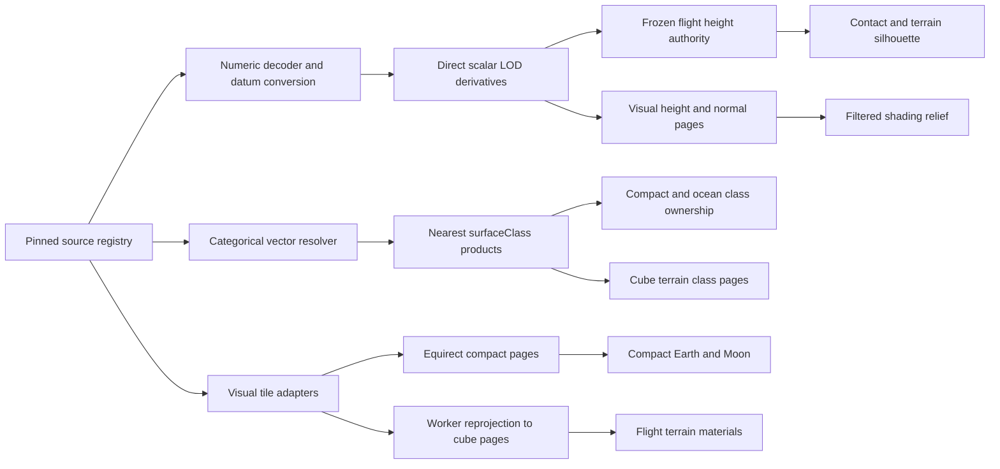

# Sol Source-Backed Visual Fidelity Correction — Implementation Plan

**Date:** 2026-07-20

**Status:** Milestones 0–2 implemented in the `fable-test` worktree. Final visual/performance validation is left to the user by request. Milestone 3 remains an unapproved conditional gate. See `docs/performance/reference/sol-source-backed-visual-fidelity-implementation-2026-07.md` for delivered evidence and remaining limitations.

**Scope:** Sun, Earth, and Moon visuals and physical presentation scale. Artemis IV mission presentation, mission gameplay, progression, vehicle balance, save migration, and unrelated worktrees remain deferred.

**Supersedes:** This is the corrective follow-on to:

- `docs/superpowers/plans/2026-07-19-sol-earth-moon-visuals-and-scale.md`;
- `docs/superpowers/specs/2026-07-19-sol-visual-contract.md`;
- `docs/superpowers/plans/2026-07-20-near-ground-visual-completion.md`.

Those documents remain the history and regression baseline. This plan replaces their assumptions that resident global packs are sufficient for low orbit and that water classification may be derived from a filtered height/material channel.

## Goal

Keep the physically scaled Sun–Earth–Moon system and the NASA-style scientific-visualization direction, while correcting the authority defects that currently produce blurry orbital surfaces, stretched low-altitude imagery, false water around Kennedy Space Center, unstable coastline shapes, and inconsistent Earth/Moon relief.

The completed system must provide:

- recognizable, source-backed Earth and Moon identity from full disk through low orbit;
- sharper source-backed visual detail near Kennedy Space Center and selected lunar regions without requiring hand-authored textures;
- one declared numeric height authority and datum contract, with every derived level traceable directly to that authority;
- categorical surface classification that is never bilinearly interpolated, mip-averaged, or inferred from visual color;
- deterministic offline fallback when source services are unavailable;
- bounded streaming, decoding, GPU residency, persistent caching, and serverless cost;
- no geometric surface that can visibly diverge from the contact surface under a craft;
- the existing user-approved low-altitude atmosphere presentation without restoring the rejected blue orbital wash.

## Non-goals

- Artemis IV chronology, narration, phase UI, replay controls, or cinematic mission cameras;
- save compatibility or migration;
- live weather, live clouds, seasonal imagery, tides, or real-time ephemerides;
- a general-purpose global GIS platform;
- survey-grade height everywhere on Earth and the Moon in the first delivery;
- arbitrary runtime URLs, user-supplied tile sources, or unbounded third-party proxying;
- repainting or manually authoring planet textures;
- changing the Sun unless the regression audit finds a concrete visual/scale defect.

## Why the current renderer loses fidelity

This is a pipeline failure, not one shader bug.

1. Earth Medium and High albedo are only 2048×1024 and 4096×2048. At the equator that is approximately 19.6 km and 9.8 km per texel. Low-orbit views magnify a handful of source texels.
2. The compact spheres have only 64×40, 96×64, and 160×96 segments. Compact relief is sampled only at those vertices.
3. `scripts/compile-planet-assets.ts` first resamples numeric height into visual pack PNGs. `scripts/compile-height-authority.mjs` then downsamples the already-resampled Medium PNG to 512×256, and `src/sim/sourceHeightAuthority.ts` bilinearly samples that grid. The CPU authority is derived from a visual derivative instead of the numeric source.
4. `scripts/lib/scientific-global-maps.ts` derives water as `height < 0` after resampling and packs it into the material texture. `src/render/terrestrial/oceanMaterial.ts` linearly samples that channel, discards only values at or below 0.01, and renders every larger fraction as opaque ocean.
5. The launch-site terrain envelope raises the height around Kennedy Space Center but cannot change that ocean channel. The pad can therefore have positive contact terrain and opaque ocean in the same place.
6. Procedural local relief and local material noise add scale cues, not missing geography. They cannot reconstruct coastlines, roads, craters, or lunar basins absent from the resident maps.
7. Compact and flight terrain are separate presentation paths, but flight terrain geometry and contact currently share `evaluateRecipeHeight`. High-resolution streamed height cannot displace only the render mesh without creating a second ground surface.

## Evidence that must remain pinned

The following control points initiated this correction. Store the exact raw/derived values and source fingerprints in a checked diagnostic fixture; do not copy them into production logic.

| Control point | Source observation | Current derived observations |
| --- | --- | --- |
| Earth, KSC 28.5728722°, −80.6489808° | ETOPO source pixel about +1.16 m EGM2008; live 3DEP sample about +5.94 m NAVD88 | Medium about −6.26 m; High about −3.50 m; CPU grid about −13.75 m; filtered water differs by tier |
| Moon 0°, 0° | source about −726.13 m | High about −727.95 m; Medium about −744.79 m; CPU about −775.75 m |
| Moon −87.5°, 45° | source about −2342.63 m | High about −2343.66 m; Medium about −2338.83 m; CPU about −3036.38 m |

The implementation must add transects, not rely only on these points:

- Earth latitude 28.6272°, longitude −80.95° through −80.25°;
- the antimeridian and both poles;
- a GSHHG lake/island hierarchy case;
- NWI deepwater, intertidal, wetland, inland-water, and land examples around KSC;
- a lunar equatorial relief transect and a south-pole transect.

## Decisions locked by this plan

### 1. Five independent data roles

Never use one channel as a shortcut for another.

| Role | Data semantics | Legal filtering |
| --- | --- | --- |
| Numeric height | continuous metres relative to a declared body datum | named numeric resampling with measured error |
| Surface class | categorical land/open ocean/estuary/intertidal/inland water/unknown | point-in-polygon or nearest only; no mip averaging or crossfade |
| Albedo | visual radiance/reflectance presentation | filtered, mipmapped, and crossfaded |
| Material | roughness/reflectance/emission/cloud response | filtered and crossfaded where physically sensible |
| Shading normal | source-height derivative plus filtered sub-source detail | filtered by projected footprint; never contact authority |

### 2. Three surface meanings

- **Contact height** is queried by simulation and vessel placement.
- **Geometric silhouette** is the displaced flight-terrain mesh.
- **Shading relief** is normal/parallax response and cannot change collision.

Flight-terrain contact and silhouette move together or not at all. Streamed height may improve shading before geometric promotion, but that phase must not claim to deliver source-accurate silhouette relief. Compact/orbital presentation geometry may be more detailed only if its approach transition is proven not to expose a shape discontinuity.

### 3. One authority, multiple direct derivatives

“One numeric authority” does not mean one raster resolution. It means:

- one versioned source product per coverage zone;
- one horizontal frame, vertical datum, scale/offset, nodata rule, and seam convention;
- every LOD derived directly from decoded scalar samples from that source;
- a checked digest and error summary for every derivative;
- no CPU/query product derived from a visual PNG, normal map, compressed GPU texture, or another downsample.

### 4. Surface classification owns water

The categorical resolver produces these stable codes:

| Code | Meaning | Ocean-cap behavior |
| --- | --- | --- |
| 0 | unknown | never render water; fall back to the next complete parent authority |
| 1 | land | no water |
| 2 | open ocean or marine deepwater | render ocean |
| 3 | estuarine deepwater | render water with estuary material policy |
| 4 | marine/estuarine intertidal | static land-at-mean-high-water policy in this pass |
| 5 | inland water | no ocean cap; reserve for a later inland-water renderer |
| 6 | wetland/aquatic vegetation | land material in this pass |

The GPU representation may be normalized R8 where integer samplers are unavailable, but it must use `NearestFilter`, no mipmaps, exact code centers, and an enumerated decode. A filtered `texture2D(...).b > 0.01` ownership decision is forbidden.

### 5. Class-source precedence and cutlines

- GSHHG full-resolution polygons are the checked global base.
- Inside the pinned NWI KSC coverage polygon, NWI wins.
- NWI `E1/M1` deepwater maps to open-ocean or estuarine-deepwater according to its system; `E2/M2` intertidal maps to static land; river/lake/pond maps to inland water; other wetlands map to wetland/land.
- Rasterization uses sample-center point-in-polygon with no antialiasing.
- NWI coverage boundaries must be clipped through stable open ocean or stable inland land. A cutline may not cross the Banana River, Indian River Lagoon, pad shoreline, or another mixed tidal region.
- Unknown child samples inherit a complete parent class. They are never inferred from height or albedo.

The resident Earth pack contains two class products:

- a complete global R8 class parent at the corresponding pack dimensions for full-disk, MapView, and fallback use;
- a pinned KSC regional R8 class page at **30 m or finer sample spacing**, with an explicit WGS84 coverage polygon, UV transform, dataset digest, and no-data code 0 outside that polygon.

The KSC page must cover LC-39B, the launch-pad exclusion area, Banana River, Indian River Lagoon, and a stable Atlantic-open-ocean sample. Its cutline is chosen after the oracle scan so every edge crosses only stable land or stable open ocean. It is tiled or packed so its uncompressed R8 allocation is no more than 8 MiB in the active resident pack. A shader/CPU resolver samples the regional page first, accepts only a nonzero exact class code, and otherwise samples the complete global parent. Thirty metres is an initial maximum spacing, not permission to blur the vectors: the acceptance transect must prove that the pad, lagoon, and Atlantic occupy distinct stable samples before this resolution is approved.

### 6. Vertical zero

- Earth engine height zero is **orthometric metres relative to the EGM2008 geoid presentation surface**, added to the checked spherical Earth reference radius. This is a visual/game presentation datum, not a survey datum: the geoid is only an approximation to mean sea level and regional mean dynamic topography can differ by roughly metre scale. It is not a claim that EGM2008 or mean sea level is spherical.
- ETOPO EGM2008 values enter directly after declared source decoding.
- The probe must confirm the vertical datum actually served by the selected 3DEP raster; do not assume every ImageServer mosaic item is NAVD88. A NAVD88 item must be converted through a pinned NOAA VDatum/geoid-difference pipeline, including the applicable GEOID18 and EGM2008 models, rather than a constant offset. The transformation IDs, grid checksums, coverage, and residual error belong in the source lock.
- Ocean classification does not use the sign of height after this conversion.
- Moon height zero is metres relative to the Moon product’s declared 1,737,400 m reference sphere. The Moon Trek LOLA scale, offset, nodata, longitude, and pole conventions must pass numeric control-point tests before becoming authority.

### 7. Two GPU mappings, one source registry

- Compact/orbital spheres use source-native equirectangular pages.
- Cube-quadtree flight terrain uses cube-face pages keyed by the existing `TerrainTileId`.
- Source equirectangular imagery/height is reprojected to cube pages in a worker with a one-texel or larger neighbor gutter. Terrain shaders do not perform source-tile lookup across an equirectangular pole singularity.
- Compact and terrain consumers share dataset version, body-fixed orientation, class semantics, and transition generation; they do not need to share one GPU atlas layout.

### 8. Offline correctness ships before streaming

The false-ocean and authority-pipeline fixes do not wait for a new runtime tile system. Milestone 1 uses the existing checked pack transaction, performs no runtime third-party fetches, and can ship independently.

### 9. Runtime height never changes contact during a flight

High-resolution geometric height becomes contact authority only through a separately gated `PlanetDataAuthority` established before simulation recipes, terrain providers, worker pools, renderers, and vessel placement are constructed. A flight freezes one authority generation. Missing or late network tiles cannot promote the ground beneath a vessel.

## Source decision and observed delivery capability

These probes were performed on 2026-07-20. The checked probe script must revalidate them; a one-time successful request is not permanent authority.

| Dataset | Role | Observed delivery | Decision |
| --- | --- | --- | --- |
| NASA GIBS Blue Marble Next Generation 500 m | Earth full-disk/orbital albedo | WMTS sample returned JPEG, CORS `*`, public caching | primary Earth orbital visual source; checked resident pack remains fallback |
| USGS 3DEP ImageServer | KSC numeric height | F32 TIFF `exportImage` returned CORS `*`; US coverage; mutable mosaic | primary KSC numeric source after raster/version and datum conversion are pinned |
| USDA NAIP CONUS ImageServer | KSC albedo | latest mutable service, about 0.3 m advertised pixel size, no CORS header observed | visual only; pinned acquisition/raster through the allowlisted proxy or a bounded regional snapshot |
| NOAA GSHHG 2.3.7 | global surface class | WGS84 hierarchical closed polygons; LGPL; offline download | global class base; never treated as a tile service |
| USFWS NWI | KSC surface class refinement | HUC8/state download with Cowardin codes; runtime query was not reliable in the probe | pinned offline KSC subset; no hard runtime dependency |
| NASA Moon Trek WAC 303 ppd | lunar orbital albedo | WMTS JPEG returned CORS `*` | primary streamed Moon visual source |
| NASA Moon Trek LOLA global 128 ppd | lunar numeric height | F32 ImageServer TIFF returned CORS `*`; decoded samples near 0°,0° match the existing LOLA source in metres | candidate global lunar numeric source after checked metadata/nodata tests |
| NASA Moon Trek LOLA south-pole 5 m / 100 m | polar numeric height | numeric ImageServer products, CORS `*` | candidate bounded polar detail source |
| Mapzen/AWS Terrarium | global height | old 2017 object; no CORS observed | reject as primary |
| Cesium Moon | complete 3D Tiles product | hosted vendor/account integration | defer; reconsider only if custom Moon streaming fails its feasibility gate |

Primary references:

- NASA GIBS: `https://nasa-gibs.github.io/gibs-api-docs/`
- USGS 3DEP: `https://elevation.nationalmap.gov/arcgis/rest/services/3DEPElevation/ImageServer`
- USDA NAIP: `https://apps.geo.fpac.usda.gov/geo-imagery/rest/services/naip/conus_naip/ImageServer`
- NOAA GSHHG: `https://www.ngdc.noaa.gov/mgg/shorelines/shorelines.html`
- USFWS NWI: `https://www.fws.gov/program/national-wetlands-inventory/data-download`
- NASA Moon Trek: `https://trek.nasa.gov/tiles/apidoc/trekAPI.html?body=moon`

## Architecture overview



## Worktree and change discipline

- Implement only in `/Users/nicknetraganti/Desktop/Developer Stuff/Perilune/fable-test` on `feature/sol-earth-moon-visuals` unless the user explicitly redirects the work.
- Do not read from, merge, or modify the body-position, EVA, map-transfer, OpenAI-context, or reentry-VFX sibling worktrees.
- Before each phase, record `git status --short`, the branch SHA, current generated-asset sizes, and reference captures.
- Existing generated files are replaced only by the named compiler command and must pass `--check` mode.
- Do not add a new full-planet maximum-resolution pyramid to Git or Vercel output.

---

## Milestone 0 — Freeze source and diagnostic contracts

### Task 0: Add a checked detail-source registry and repeatable probes

**Files:**

- Create: `assets/planets/sol-detail-source-lock.json`
- Create: `scripts/probe-planet-detail-sources.mjs`
- Create: `scripts/lib/planet-source-registry.mjs`
- Modify: `scripts/validate-content.mjs`
- Modify: `package.json`
- Create: `tests/planet-detail-source-lock.test.ts`

**Requirements:**

- Give every source a stable dataset ID, body, role, coverage polygon, source version/layer, raster/acquisition IDs where supported, CRS, longitude convention, vertical datum, scale/offset, nodata, MIME type, URL template or ArcGIS operation, license/attribution, expected CORS route, and sample fingerprints.
- A `latest` mosaic cannot be a lock. Resolve NAIP and 3DEP catalog/raster identifiers before production use.
- Probe only an explicit allowlist. Verify status, MIME, maximum response size, CORS when direct access is expected, cache headers, encoding, dimensions, and sample fingerprint.
- CI may skip live probes when network is unavailable, but checked metadata/schema tests may not skip. A deliberate scheduled/manual probe updates the evidence report; it does not silently rewrite the lock.
- Record government/public-domain status or license terms per product. Do not treat all NASA/USGS-hosted artifacts as having one license.

**Acceptance:**

- A changed endpoint, unexpected HTML response, missing CORS, changed raster ID, or decode mismatch fails with the dataset ID and operation.
- The probe cannot be redirected to an unlisted host.

### Task 1: Add numeric and categorical inspection tools

**Files:**

- Create: `scripts/inspect-planet-authority.mjs`
- Create: `tests/planet-height-oracles.test.ts`
- Create: `tests/surface-class-oracles.test.ts`
- Modify: `docs/performance/reference/sol-near-ground-completion-2026-07.md` only by appending a link to the new baseline report
- Create: `docs/performance/reference/sol-source-authority-baseline-2026-07.md`

**Requirements:**

- Sample raw source, each derived height LOD, current CPU/query authority, launch envelope, and surface class at named coordinates and transects.
- Report absolute error, sign changes, min/max, nodata count, source footprint, interpolation kernel, and vertical datum. A screenshot is not height evidence.
- Implement a CPU mirror of GPU surface-class decoding. Assert exact codes; do not compare blended colors.
- Capture current station images, but label them supporting visual evidence rather than numeric proof.

**Stop gate:** Do not modify the height or ocean pipeline until the current KSC and lunar discrepancies reproduce through this tool.

---

## Milestone 1 — Offline authority correctness

This milestone fixes false water and the derivation chain with no runtime network dependency and no new global high-resolution pyramid.

### Task 2: Decode numeric source once and derive every global level directly

**Files:**

- Modify: `scripts/compile-planet-assets.ts`
- Modify: `scripts/lib/scientific-global-maps.ts`
- Replace: `scripts/compile-height-authority.mjs` input contract
- Modify: `src/generated/checked-height-authority.ts` through the generator only
- Modify: `src/sim/sourceHeightAuthority.ts`
- Modify: `src/sim/terrainRecipe.ts`
- Modify: `assets/planets/sol-source-lock.json`
- Modify: `tests/macro-height-field.test.ts`
- Modify: `tests/terrain-authority.test.ts`
- Modify: `tests/scientific-global-maps.test.ts`
- Create: `tests/scientific-height-derivation.test.ts`

**Implementation contract:**

- Decode source height into scalar metres before resize or RG packing.
- Derive Low/Medium/High visual height and the 512×256 global query grid independently from that scalar source. The query grid may remain 512×256 in this milestone to avoid turning a generated TypeScript file into a multi-megabyte payload; its remaining resolution error must be measured and documented.
- Use a named numeric kernel per product. Preserve nodata separately from valid negative elevation. No RGB/image color-space operation may touch numeric samples.
- Quantize only at the final consumer encoding. Store quantization scale/offset and worst/RMS error in the checked manifest.
- Change the generated height artifact’s `sourcePath` and `sourceSha256` to the numeric source/decoded authority, not the Medium visual PNG.
- Include the checked height-authority version/digest in `recipeContent` so changed contact values change the recipe hash deterministically.
- State plainly in release notes and tests: this rebuild changes contact-height values at startup/build time and invalidates old recipe hashes. Save migration remains out of scope.
- Record every full-suite failure caused by changed contact-height goldens (including ascent, landing, pad placement, and terrain-contact fixtures), inspect it against the new numeric oracle, and update it only when the new authority value is proven. Do not bulk-refresh goldens.
- Keep the launch envelope as a height rule only. Do not make it classify water.

**Acceptance:**

- The compiler test proves each derivative begins from the same decoded source buffer, not another output.
- Reordering visual-pack compilation cannot change the CPU grid digest.
- Source, visual, and CPU errors are reported at all pinned points; the Moon −87.5°/45° error is no longer an unexplained consequence of Medium-PNG → nearest-downsample derivation.
- `npm run compile:height-authority -- --check` detects stale source, metadata, or recipe digest.

### Task 3: Create surfaceClass independently from height/material

**Files:**

- Create: `scripts/lib/surface-classification.mjs`
- Create: `assets/planets/classification/gshhg-2.3.7.lock.json`
- Create: `assets/planets/classification/nwi-ksc.lock.json`
- Modify: `scripts/compile-planet-assets.ts`
- Modify: `assets/planets/manifest.json` through the generator
- Modify: `src/render/planetAssetLoader.ts`
- Modify: `src/render/bodyRenderer.ts`
- Modify: `src/render/terrestrial/globalMaterial.ts`
- Modify: `src/render/terrestrial/surfaceMaterial.ts`
- Modify: `src/render/terrestrial/oceanMaterial.ts`
- Modify: `src/render/terrestrial/ocean.ts`
- Modify: `src/render/terrestrial/scatter.ts`
- Modify: `src/render/terrestrialBodyRenderer.ts`
- Modify: `src/ui/mapView.ts`
- Create: `tests/surface-classification.test.ts`
- Modify: `tests/veyra-assets.test.ts`
- Modify: `tests/sol-asset-provenance.test.ts`
- Modify: `tests/veyra-global-material.test.ts`
- Modify: `tests/veyra-ocean.test.ts`
- Modify: `tests/scatter-profile.test.ts`
- Modify: `tests/scatter-recipe.test.ts`
- Modify: `tests/ocean-cap.test.ts`
- Modify: `tests/terrestrial-body-renderer.test.ts`

**Implementation contract:**

- Add an explicit `surfaceClass` channel. Stop using packed material blue as ownership authority. The old blue channel may remain a visual material value during migration, but it cannot decide water.
- Rasterize GSHHG hierarchy and the pinned NWI subset by sample-center point-in-polygon. No antialiasing, coverage fractions, or image resize kernel.
- Apply the precedence, tidal convention, wetland mapping, and stable cutline defined above.
- Configure runtime class textures as nearest, clamp vertically/repeat horizontally where applicable, and no mipmaps. Add a test that fails if a class texture is `LinearFilter` or has generated mips.
- Compact land/ocean shading, flight terrain material choice, ocean-cap discard, scatter suppression, and MapView must call one class decoder/contract. `TerrestrialScatterFrame` receives a CPU `SurfaceClassSampler`; the existing Earth `surface.height < 0` dry-land predicate is removed.
- Earth geology scatter is permitted only for exact class 1 (land) in this pass. Codes 0, 2, 3, 4, 5, and 6 suppress Earth scatter. Moon profiles remain solid-body profiles with no Earth class sampler, so valid negative lunar elevation is not treated as water. Veyra retains its existing profile-specific policy until it has an authored classification product; it may not silently consume Earth's code meanings.
- The ocean cap renders only codes 2 and 3. Unknown, land, intertidal, inland water, and wetland do not receive the opaque global ocean cap.
- Foam/shore width uses a bounded local screen-space rule in Milestone 1. It is not a fractional class sample. A signed shoreline-distance raster is deferred unless separately specified with its own source, resolution, memory budget, provenance, and seam tests.

**Acceptance:**

- KSC pad, pad perimeter, Banana River, Indian River Lagoon, and Atlantic samples match the checked categorical oracle.
- Changing quality tier does not change class at a fixed coordinate.
- Sun direction, camera distance, and texture anisotropy cannot change class.
- The antimeridian and GSHHG lake/island nesting pass.
- MapView and flight view return the same class code for the same body-fixed coordinate.
- Scatter tests prove a negative-height Earth sample classified as land remains eligible, a positive-height lagoon sample classified as water is rejected, and valid negative lunar terrain remains eligible.

### Task 4: Ship Milestone 1 independently

**Verification:**

```bash
npm run check:height-authority
npm run validate:content
npx vitest run tests/scientific-height-derivation.test.ts tests/macro-height-field.test.ts tests/terrain-authority.test.ts tests/scientific-global-maps.test.ts tests/surface-classification.test.ts tests/veyra-assets.test.ts tests/sol-asset-provenance.test.ts tests/veyra-global-material.test.ts tests/veyra-ocean.test.ts tests/scatter-profile.test.ts tests/scatter-recipe.test.ts tests/ocean-cap.test.ts tests/terrestrial-body-renderer.test.ts tests/map-material.test.ts tests/map-body-placement.test.ts
npm test
npm run typecheck
npm run build
npx playwright test e2e/sol-visual-reference.spec.ts
```

Add KSC station variants before capture:

- `earth-ksc-ground` at the launch pad;
- `earth-ksc-1km`;
- `earth-ksc-coast-transect`;
- `earth-low-orbit` at two sun directions;
- a class-debug capture with atmosphere/clouds disabled.

**Milestone 1 is complete when:**

- false water around KSC and the sun-dependent coastline shapes are gone;
- CPU and visual height products have one direct provenance chain with quantified error;
- offline launch, orbit, MapView, and fallback behavior use no third-party request;
- no claim is made that 512×256 geometry has gained high-resolution geographic relief.

---

## Milestone 2 — Bounded source-backed visual detail

This milestone addresses orbital blur and stretched surface imagery. It is a new subsystem and deliberately reverses the old “runtime never fetches a tile service” assumption.

### Task 5: Prove source adapters and memory budgets in the reference prototype

**Files:**

- Create: `src/render/planetDetail/sourceRegistry.ts`
- Create: `src/render/planetDetail/sourceAdapter.ts`
- Create: `src/render/planetDetail/arcGisImageAdapter.ts`
- Create: `src/render/planetDetail/wmtsAdapter.ts`
- Create: `src/render/planetDetail/detailBudget.ts`
- Create: `src/proto/planetDetailProto.ts`
- Create: `tests/planet-detail-source-adapter.test.ts`
- Create: `tests/planet-detail-budget.test.ts`
- Create: `e2e/planet-detail-feasibility.spec.ts`

**Prototype matrix:**

- GIBS Blue Marble at `earth-low-orbit`;
- one pinned NAIP acquisition at `earth-ksc-1km`;
- Moon Trek WAC at `moon-low-orbit`;
- Moon Trek global LOLA F32 and south-pole numeric TIFF decode;
- 3DEP F32 decode and Earth vertical-datum conversion;
- offline, 404, timeout, HTML-instead-of-image, corrupt TIFF, stale request cancellation, and source-version mismatch.

**Initial budgets to prove or revise with evidence:**

| Budget | Low | Medium | High |
| --- | ---: | ---: | ---: |
| Runtime detail | disabled | enabled | enabled |
| Incremental detail GPU | 0 | 32 MiB | 64 MiB |
| Decoded CPU tile cache | 0 | 24 MiB | 48 MiB |
| Persistent source cache | 0 | 256 MiB | 512 MiB |
| Concurrent source requests | 0 | 4 | 6 |
| Same-origin proxy invocations per active-body cold session | 0 | 96 | 192 |
| Same-origin proxy egress per active-body cold session | 0 | 48 MiB | 96 MiB |
| Per-frame decode/upload CPU p50 | 0 | ≤2 ms | ≤3 ms |

Do not raise the existing active-body budget silently. Detail allocations are charged to `RendererResourceLedger` or a named subordinate ledger and appear in renderer stats.

**Feasibility gate:** Do not integrate production materials until the prototype shows correct north/south, seam, source version, failure fallback, and bounded memory on both Earth and Moon.

### Task 6: Add an allowlisted delivery and cache boundary

**Files:**

- Create: `api/planet-data.ts`
- Create: `src/render/planetDetail/tileRequest.ts`
- Create: `src/render/planetDetail/persistentTileCache.ts`
- Modify: `vite.config.ts`
- Modify: `vercel.json`
- Create: `tests/planet-data-api.test.ts`
- Create: `tests/persistent-planet-cache.test.ts`

**Rules:**

- Use direct CORS access for immutable/pinned GIBS and Moon Trek products when policy permits. Use the same-origin route for NAIP and any normalized response format.
- The API accepts a checked dataset ID plus validated tile/image coordinates. It never accepts a URL, host, protocol, path traversal, arbitrary ArcGIS endpoint, auth header, or caller-selected response size.
- Each dataset adapter defines its upstream host, path template, maximum dimensions, format, timeout, maximum bytes, and allowed query parameters.
- The production handler enforces a 10-second upstream timeout and a 2 MiB maximum decoded response body per invocation; a dataset may set stricter bounds but not looser ones.
- CDN/cache keys include dataset ID, locked version/raster ID, projection, level, row, and column. Mutable `latest` is forbidden.
- Return explicit cache/fallback metadata without exposing upstream internals or credentials.
- Abort requests after camera/body/generation changes. Retry with bounded exponential backoff and jitter; do not retry permanent decode/schema failures.
- Persistent browser storage is content-addressed and LRU-evicted to the tier budget. A source-lock change creates a new namespace; old entries are eligible for eviction.
- CSP adds only the exact direct source hosts that remain necessary. `img-src` is not a substitute for `connect-src` when data is fetched for decoding.
- Production-parity integration runs through `vercel dev` so the same-origin handler and `vercel.json` routes are exercised. Plain `vite dev` may use direct-CORS locked sources and the resident fallback for proxy-only NAIP; it must not grow a permissive development proxy. Unit tests invoke the handler directly.
- Proxy-backed runtime detail defaults off until deployment configuration supplies `PLANET_DETAIL_MONTHLY_COST_CEILING_USD` and a documented estimate at current Vercel rates for 10,000 cold and 10,000 warm active-body sessions remains below that ceiling. If the estimate, invocation budget, or egress budget is absent or exceeded, the adapter returns the resident fallback instead of issuing the request.

### Task 7: Stream compact/orbital equirectangular visual pages

**Files:**

- Create: `src/render/planetDetail/equirectPageTable.ts`
- Create: `src/render/planetDetail/compactDetailController.ts`
- Modify: `src/render/terrestrial/globalMaterial.ts`
- Modify: `src/render/airless/globalMaterial.ts`
- Modify: `src/render/terrestrial/globalGeometry.ts`
- Modify: `src/render/terrestrialBodyRenderer.ts`
- Modify: `src/render/airlessBodyRenderer.ts`
- Modify: `src/render/bodyRendererManager.ts`
- Create: `tests/compact-detail-controller.test.ts`
- Create: `tests/equirect-page-table.test.ts`

**Rules:**

- Resident checked albedo/normal/height remains a complete parent at all times.
- Select detail LOD from projected texel footprint and drawing-buffer size, not altitude alone.
- A child page becomes eligible only after decode, orientation validation, gutter construction, GPU upload, and source-generation validation complete. Until then the complete parent remains visible.
- Albedo and shading normal may crossfade over a named time window. Surface class never crossfades.
- Avoid downloading a whole maximum-resolution planet. Request only visible pages plus one bounded prediction ring.
- Do not use streamed high-resolution height to change compact silhouette unless the compact→terrain geometric transition has a numeric continuity proof. Shading normals/parallax are allowed and must be footprint-filtered.
- MapView remains on the corrected resident pack in this milestone. It does not create a second uncontrolled detail cache.

**Visual targets:**

- Earth 250 km no longer magnifies 10–20 km texels;
- Moon 100 km resolves WAC geography without baked color hillshade;
- Earth full disk, Earth–Moon true scale, and Moon-from-Earth remain stable and do not fetch unnecessary high-detail pages.

### Task 8: Reproject source pages into cube-quadtree terrain pages

**Files:**

- Create: `src/render/planetDetail/cubePageReprojector.ts`
- Create: `src/render/planetDetail/terrainDetailController.ts`
- Create: `src/render/planetDetail/detailWorker.ts`
- Modify: `src/render/terrain/planetTerrainEngine.ts`
- Modify: `src/render/terrain/chunkGeometry.ts`
- Modify: `src/render/terrain/chunkWorker.ts`
- Modify: `src/render/terrestrial/surfaceMaterial.ts`
- Modify: `src/render/airless/surfaceMaterial.ts`
- Create: `tests/cube-page-reprojection.test.ts`
- Create: `tests/terrain-detail-controller.test.ts`
- Modify: `tests/local-material-sampling.test.ts`

**Rules:**

- Key terrain pages by `TerrainTileId` and the locked source generation.
- Reproject in a worker from decoded source samples to cube-face page texels. Add neighbor gutters and test all cube edges/corners.
- The selected terrain leaves drive requests. Reuse scheduler priority classes: coverage parent first, visible refinement next, prediction last.
- Terrain chunks keep the resident parent page until the complete child page is installed. A four-child visual mosaic does not partially replace its parent.
- Derive shading normals from decoded numeric height with neighboring samples in the worker. Do not generate and ship a second global normal pyramid.
- In Milestone 2, source height affects shading normal/parallax only. Vertex positions and contact continue to use the frozen checked height recipe.
- Cap parallax below the measured cell/height error so it cannot look like geometry the silhouette contradicts. Disable it at grazing angles when the mismatch becomes apparent.
- KSC NAIP and 3DEP activate only inside their locked coverage. GIBS/ETOPO parent data remains complete outside.

### Task 9: Preserve the approved atmosphere, ocean, cloud, and Sun contracts

**Files:**

- Modify only if evidence requires: `src/render/terrestrial/atmosphere.ts`
- Modify only if evidence requires: `src/render/terrestrial/atmosphereMaterial.ts`
- Modify: `src/render/terrestrial/aerialPerspective.ts`
- Modify: `src/render/terrestrial/oceanMaterial.ts`
- Modify: `src/proto/solVisualReferenceStations.ts`
- Modify: `tests/aerial-perspective-shared.test.ts`
- Modify: `tests/veyra-atmosphere.test.ts`
- Create: `tests/atmosphere-shell-seam.test.ts`

**Ledger:**

- Preserve shell quaternion alignment from `6fe6f92`.
- Preserve the user-approved fade of shell/aerial blue presentation above the low-altitude band from `5146d5d`. Do not restore a full-globe blue overlay in orbit.
- Preserve transmittance, multiple-scattering, sky-view, and aerial-perspective LUT use.
- Preserve the removal of the old opaque orbital ocean band, but replace its semantic mask path with `surfaceClass` rather than another altitude workaround.
- Verify cloud and atmosphere seams at longitude ±180°, the equator, both poles, and two sun directions.
- Keep the current Sun implementation unchanged unless `sun-from-earth`, occultation, exposure, or angular-size regression fails.

### Task 10: Complete Milestone 2 visual and operational acceptance

**Numeric gates:**

- source page address and body-fixed coordinate round-trip;
- equirect page seam and pole orientation;
- cube reprojection edge/corner continuity;
- exact class code consistency between CPU oracle, compact shader inputs, terrain shader inputs, ocean, and MapView;
- decoded 3DEP/LOLA metre values and declared datum conversion;
- projected source texel size versus displayed pixel footprint;
- angular-size contract for Sun, Earth, and Moon;
- memory, request, cache, and upload budgets.

**Visual gates:**

- `earth-day-full`, `earth-low-orbit`, `earth-100km`, `earth-ksc-1km`, `earth-ksc-ground`, `earth-ocean-horizon`;
- `moon-near-full`, `moon-far-full`, `moon-polar`, `moon-low-orbit`, `moon-surface`;
- `earth-moon-true-scale`, `moon-from-earth`, `sun-from-earth`, `sun-partial-occultation`;
- day, terminator, and night variants where source/class defects were sun-dependent;
- forced parent fallback, cold cache, warm cache, offline, timeout, and corrupt-response variants.

**Performance stop rules:**

- Medium steady-state frame p50 regression over 1 ms versus the July 20 reference stops integration;
- unexplained p95 increase, main-thread task over 50 ms, active-body budget overrun, more than the tier request limit, or repeated source retries stops integration;
- more than the tier's cold-session proxy invocation or egress budget, a warm-cache origin-hit ratio above 5%, or a current-rate monthly estimate above the configured cost ceiling stops proxy-backed integration;
- no detail request may block simulation stepping;
- a cold-cache source failure must present the resident parent without a hole, flash, black tile, class change, or camera jump.

---

## Milestone 3 — Gated source-height promotion for true geometric relief

This milestone is required before claiming source-accurate terrain silhouette at the surface. It is not required to ship Milestones 1–2. It changes deterministic contact values and therefore must be reviewed as a separate implementation gate even though saves are disposable.

### Task 11: Establish PlanetDataAuthority before simulation and renderer construction

**Files:**

- Create: `src/sim/planetDataAuthority.ts`
- Modify: `src/game.ts`
- Modify: `src/sim/state.ts`
- Modify: `src/sim/terrainRecipe.ts`
- Modify: `src/sim/sourceHeightAuthority.ts`
- Modify: `src/render/terrain/surfaceProvider.ts`
- Modify: `src/render/terrain/chunkWorkerPool.ts`
- Modify: `src/render/bodyRendererFactory.ts`
- Modify: `src/render/bodyRendererManager.ts`
- Modify: `src/render/worldScene.ts`
- Create: `tests/planet-data-authority.test.ts`
- Modify: `tests/renderer-transaction.test.ts`
- Create: `tests/contact-surface-generation.test.ts`

**Hard rules:**

- Build/fetch every numeric authority region required for a launch or selected landing region before constructing the flight’s recipes/providers/workers/renderers and before placing the craft.
- The exact launch boundary is `Game.launch()` in `src/game.ts`: after locked-part and funds validation, but before the current `world.prepareFlightBody(home)` call and before `game.spawnOnPad(...)`. Replace that sequence with `await game.prepareFlightAuthority(home, requestedRegion)`, then call `world.prepareFlightBody(home, frozenAuthority)`, and only then place the craft. Keep the existing minimum presentation delay parallel to preparation; the timer is not authority readiness.
- Freeze `{datasetId, version, coverage, datum, generation}` for the entire flight.
- Key terrain recipes and all provider/worker/renderer caches by authority generation, not by `Body` identity alone. The current `WeakMap<Body, BodyFeatureRecipe>` must not return a recipe from an earlier generation. Put the generation assertion inside `GameState.spawnOnPad`, not only in `Game.launch`, so both initial launch and the `Game.revert()` respawn path prove that recipe/provider generation equals the frozen flight authority. Revert reuses the already frozen generation and must not refetch or promote height.
- Contact queries and worker geometry sample the same authority generation and the same numeric interpolation contract.
- No `BodyRendererManager.transact`, quality change, camera motion, late cache fill, or source request may promote height.
- If the authority region is incomplete, corrupt, or over budget, start the flight entirely on the parent checked authority and report the fallback. Do not mix parent contact with child geometry.
- Region boundaries use matched edge samples and a documented blend band entirely within one numeric datum; the class owner remains categorical and does not blend.
- Recipe hashes include source generation and region digest. Save migration remains deferred.

### Task 12: Promote bounded regions, not an unbounded planet

**First candidates:**

- KSC launch region, because it can be preloaded at the existing VAB-to-launch wait boundary;
- the existing lunar reference/south-pole region only after the landing/reference coverage is explicitly selected and bounded.

Do not promise arbitrary high-resolution landing everywhere. Outside a loaded authority region, the complete corrected global parent remains contact and geometry authority. Visual pages may still be sharper than geometry and must obey the Milestone 2 parallax limit.

**Promotion acceptance:**

- zero craft float/clip at authority-zone entry, reload, quality change, or renderer rebuild;
- contact and mesh height agree within the final quantization tolerance at random points, tile edges, region edges, and launch-pad envelope edges;
- surface normal, slope, ocean class, and scatter placement use the same frozen generation;
- no network request occurs after the flight authority is frozen for data required by contact;
- the Moon surface claim changes from “source-informed shading” to “source-backed geometric relief” only after this gate passes.

---

## Diagnostics required in production and the reference harness

Add a compact diagnostic snapshot, not permanent decorative UI, containing:

- body, quality, presentation path, and authority generation;
- source dataset/layer/raster/acquisition ID and datum;
- resident parent/child page counts and requested/decoded/uploading/failed states;
- compact equirect and terrain cube LODs separately;
- fallback reason, retry state, cold/warm cache, and source fingerprint;
- detail GPU bytes, decoded CPU bytes, persistent bytes, request count/bytes, fetch/decode/reproject/upload timings;
- numeric height at the camera/craft point, source resolution, parent/child error, and whether it is shading-only or frozen contact authority;
- exact surface-class code and resolving source;
- atmosphere presentation visibility, ocean decision, compact/terrain coverage, and transition generation.

Diagnostic overlays for page boundaries and class ownership must be opt-in through the existing prototype/diagnostic mechanism and must never alter normal render state.

## Final completion criteria

The plan is complete only when all applicable milestones meet these statements:

1. No height product is derived from a visual derivative.
2. No water decision is derived from height sign, interpolated material blue, albedo, or atmosphere.
3. KSC is categorically land; nearby lagoon/ocean classes are stable across tier, camera, sun, and map/flight views.
4. Earth and Moon low-orbit imagery resolves substantially more source spatial frequency than the resident 4096×2048 fallback without downloading a whole maximum-resolution globe.
5. Compact and terrain visual pages transition only after complete child readiness and never expose holes, black tiles, seams, or partial mosaics.
6. Flight-terrain geometry and contact never use different height generations.
7. Low-altitude atmosphere/aerial perspective remains present; the rejected broad blue orbital tint remains absent.
8. Sun, Earth–Moon distance, apparent angular sizes, orientation, map framing, and camera-centered zoom remain regression-clean.
9. Cold cache, offline mode, source outage, corrupt data, and budget pressure fall back deterministically to the resident pack.
10. Source provenance, licensing, datum conversion, network cost, cache cost, and memory cost are measured and documented.

## Commit sequence

Use reviewable phase commits; do not combine the offline authority correction with the runtime streaming subsystem.

1. `test: pin Sol source authority diagnostics`
2. `fix: derive Sol height authority directly from numeric sources`
3. `fix: separate categorical Earth surface classes`
4. `test: prove bounded planet detail source adapters`
5. `feat: add bounded planet detail delivery and cache`
6. `feat: stream compact Sol visual detail`
7. `feat: reproject source detail onto flight terrain`
8. `test: certify Sol source-backed visual transitions`
9. Conditional after the separate gate: `feat: freeze regional planet height authority per flight`

Do not commit generated source downloads, caches, screenshots, or multi-gigabyte intermediate rasters. Commit only checked locks, bounded approved runtime artifacts, generated products already authorized by the manifest, tests, diagnostics, and reference reports.
