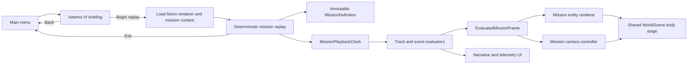

# Artemis IV Concept Replay — Implementation Plan

**Status:** Planned; pending implementation approval  
**Branch:** `feature/artemis-mission-replay`  
**Worktree:** `/Users/nicknetraganti/Desktop/Developer Stuff/Perilune/fable-test-artemis`  
**Baseline:** `integration/sol-earth-moon` at `78a5d57`  
**Source review date:** 2026-07-21

## Goal

Add a new **Artemis IV** entry to Perilune's main screen that opens a self-contained, source-backed mission replay. The first vertical slice follows Orion carrying the Lunar I-Hab to Gateway in near-rectilinear halo orbit (NRHO), completing rendezvous, docking, and activation.

The experience should feel like an interactive NASA Eyes story inside Perilune: the player can inspect, pause, scrub, change time rate, move between phases, change cameras, and toggle explanatory layers. It is a deterministic visualization, not a piloting or failure simulator.

## Product contract

These decisions are treated as approved for the first slice:

1. **Separate mode.** Artemis is isolated from the campaign/editor/flight save state.
2. **Dedicated entry flow.** Main menu card → full-screen briefing → replay → main menu.
3. **Focused story.** The initial slice covers Gateway approach through I-Hab docking and activation. Launch, translunar injection, lunar landing, and surface operations are represented in the phase timeline but are not fully simulated or rendered in this slice.
4. **Directed but explorable.** A camera director provides authored views. Any manual camera input suspends the director until the player explicitly selects **Return to Director**.
5. **Deterministic timeline.** Every visible state is evaluated directly from mission elapsed time, so pause, forward play, backward scrub, and phase jumps yield identical results.
6. **Transparent fidelity.** The UI distinguishes official mission facts, an official idealized NRHO reference trajectory, representative rendezvous choreography, and temporary proxy spacecraft visuals.
7. **Perilune identity.** Use Perilune's visual language and typography. Do not use NASA insignia, imply NASA endorsement, or add decorative live-status dots.

## Scope

### Included in the first vertical slice

- Artemis IV main-menu card and responsive three-card layout.
- Full-screen briefing with objective, scope, source/fidelity statement, and phase overview.
- Moon, Gateway, Orion/I-Hab proxy entities, reference NRHO, and representative final approach.
- Mission phases: launch/departure context, lunar arrival, NRHO rendezvous, approach, soft capture, hard dock, and activation.
- Play/pause, timeline scrub, phase navigation, time-rate selection, camera selection, and layer toggles.
- Narrative captions and telemetry derived from the same trajectory state used by rendering.
- Source/provenance metadata accessible inside the replay.
- Keyboard, pointer, touch, reduced-motion, and responsive layouts.
- Deterministic tests and repeated enter/exit cleanup checks.

### Explicitly deferred

- Exact Orion, SLS, Gateway, or I-Hab production models and part construction.
- Manual piloting, docking controls, propellant use, failures, scoring, or branching outcomes.
- Full launch, Earth departure, translunar coast, lunar landing, or surface EVA simulation.
- A claim that any authored rendezvous path is NASA's actual Artemis IV flight trajectory.
- Changes to campaign progression, autosave, Continue, editor craft, or flight state.
- Runtime SPICE evaluation or runtime network downloads.

## Source and fidelity policy

Every mission datum and visible claim carries one of four fidelity labels:

| Label | Meaning | Artemis IV use |
|---|---|---|
| `verified-source` | Directly supported by a cited NASA source | Mission objective, Orion carrying I-Hab, Gateway assembly sequence |
| `reference-trajectory` | Official engineering reference, but not a mission-specific flown ephemeris | NASA/JPL's idealized 15-year southern L2 9:2 NRHO reference |
| `representative` | Authored for explanation and constrained by cited operational concepts | Orion/I-Hab relative approach, hold points, capture timing, camera choreography |
| `proxy-visual` | Temporary geometry preserving identity and scale intent | Gateway, Orion, and I-Hab meshes until asset work begins |

The replay's persistent information panel must say, in plain language:

> Concept replay. Mission facts and the Gateway reference orbit are source-backed. Spacecraft approach timing and temporary vehicle visuals are representative, not an Artemis IV flight prediction.

The content definition stores citations next to the facts they support. Narrative copy may not promote a `representative` value to a verified fact.

### Initial authoritative sources

- NASA, **Artemis IV**: <https://www.nasa.gov/mission/artemis-iv/>
- NASA, **Gateway: About**: <https://www.nasa.gov/reference/gateway-about/>
- NASA, **Gateway Capabilities**: <https://www.nasa.gov/gateway-capabilities/>
- NASA, **NASA's Artemis IV: Building First Lunar Space Station**: <https://www.nasa.gov/general/nasas-artemis-iv-building-first-lunar-space-station/>
- NASA NTRS, **A 15-Year Near-Rectilinear Halo Orbit Reference Trajectory**: <https://ntrs.nasa.gov/citations/20190030294>
- NASA NTRS, **A Robust Navigation Design for NRHO Rendezvous**: <https://ntrs.nasa.gov/citations/20230000757>
- NASA/JPL NAIF, **DSG reference kernel directory**: <https://naif.jpl.nasa.gov/pub/naif/misc/MORE_PROJECTS/DSG/>
- NASA, **Brand Guidelines**: <https://www.nasa.gov/nasa-brand-center/brand-guidelines/>
- NASA, **Images and Media Usage Guidelines**: <https://www.nasa.gov/nasa-brand-center/images-and-media/>

NASA pages can change as the program evolves. Store the retrieval date, source URL, and a short quoted-or-paraphrased claim record in a source manifest. When official pages disagree on schedule or evolving architecture, avoid displaying a launch date unless it is necessary to the story; if displayed, attach an “as of” date.

## Current codebase assessment

- `src/game.ts` owns the top-level `menu | editor | flight` lifecycle and all transitions.
- `src/render/worldScene.ts` already owns body renderers, vessel rendering, lighting, post-processing, and orbit/chase/locked/free cameras.
- `WorldScene.update(game, dt, smokeDt)` is a flight-specific monolith. It returns early without an active `GameVessel` and also consumes craft attitude/geometry, mass properties, throttle, reentry, SRB smoke, launch-site state, terrain ownership, camera history, environment lighting, and exposure history. A mission replay cannot satisfy this API with proxy entities.
- Existing flight cameras are active-vessel-relative and frame-smoothed. Gateway, Orion, Moon, and LVLH-directed views require a mission-specific camera controller; they are not new names for the existing flight modes.
- Existing `GameState` docking advances through forward simulation and cannot be the source of truth for an arbitrary-seek replay.
- The flight model is two-body and must not be presented as generating Gateway's multi-body NRHO.
- `src/ui/input.ts` currently limits `BindingScreen` to `flight | editor`; mission replay bindings need an explicit third screen.
- Existing source-provenance machinery in `scripts/validate-content.mjs`, `scripts/lib/planet-source-registry.mjs`, and `scripts/lib/canonical-json.mjs` already provides the repository pattern for source locks and SHA-256 validation.
- The current uncommitted first slice adds the Artemis menu card, responsive menu layout, temporary briefing dialog, and menu tests. The dialog is a scaffold to replace with the dedicated briefing screen.

## Architecture



### Top-level lifecycle

Extend the top-level screen type to:

```ts
type Screen = 'menu' | 'editor' | 'flight' | 'mission-briefing' | 'mission-replay'
```

`mission-briefing` and `mission-replay` own separate UI roots. Entering Artemis must not assign to `this.game`, call `loadGame`, trigger autosave, or alter the Continue button. Exiting disposes mission UI, mission entity visuals, input handlers, body-renderer claims, and pending asynchronous entry work before returning to the menu.

Use an entry-generation token or `AbortController`. Every asynchronous prepare step must verify that its entry is still current before installing scene resources. This prevents a fast Back/Exit action from allowing a late renderer load to reopen or leak the mission.

### World rendering split and mission presentation

Do not make `GameState` implement a render-owned interface and do not disguise proxy entities as `GameVessel` objects. Preserve `WorldScene.update(game, dt, smokeDt)` as the public flight entry point and keep its observable behavior unchanged. Refactor internally, behind regression tests, into two explicit paths:

1. **Flight path:** existing active-vessel camera, terrain ownership, launch site, craft mesh synchronization, reentry, smoke, landing aid, and exposure behavior.
2. **Mission path:** a new `updateMission(frame, camera, dt)` entry that can render with no active `GameVessel`. It selects the Moon as focus body, runs only the shared celestial-body/lighting stage, renders immutable mission entity poses, and skips flight terrain ownership, launch-site rendering, craft throttle/mass logic, reentry, SRB smoke, and landing aids.

Extract only the truly shared body operations from the existing monolith: camera-relative celestial transforms, render-set selection, body-renderer updates, occlusion/solar direction, background/environment setup, and renderer lifecycle. The input to this internal stage must state its focus body and absolute camera pose explicitly rather than inferring them from an active vessel.

The pure mission evaluator emits an `EvaluatedMissionFrame` in `src/mission/types.ts` with mission time, phase/events, body-relative entity position/velocity, entity attitude, attachment state, telemetry, and director cue target. It contains ids and math values, not Three.js objects or renderer handles. `src/render/missionEntityRenderer.ts` maps those ids to replaceable visual providers and applies camera-relative transforms each frame.

Gateway, Orion, and I-Hab remain stable scene objects owned by the mission renderer. Hard docking does not reparent objects as a historical mutation: on every evaluated frame, the docked Orion/I-Hab world pose is recomputed from Gateway pose × docking transform. Seeking backward therefore restores the independent approach pose without scene-graph repair.

The first slice supplies labelled proxy geometry for the mission entities. Later asset work replaces only the visual providers, not mission evaluation, telemetry, or screen lifecycle. No interface is added under `src/render/` that `src/sim/` must import; this preserves the repository's simulation-to-render dependency direction.

### Mission data model

Create a runtime-validated `MissionDefinition` containing:

- Stable id, title, revision, retrieval date, summary, objective, and disclaimer.
- Source records with URL, publisher, retrieval date, supported claim, and fidelity label.
- Entities with stable ids, display labels, body/parent relationship, visual provider, and scale policy.
- Phases with half-open time ranges `[start, end)`, title, narrative, default camera cue, suggested rate, and supported claims.
- Position/velocity tracks with coordinate frame, epoch, SI units, interpolation rule, fidelity label, and samples/keyframes.
- Attitude tracks using normalized quaternions and shortest-path SLERP.
- Discrete events such as hold-point arrival, soft capture, hard dock, and activation.
- Camera cues expressed relative to a body, entity, or Gateway LVLH frame.
- Layer definitions and telemetry channel definitions.

Use mission elapsed seconds as the runtime timeline. Preserve the source epoch and frame in generated-track metadata. Store the selected track epoch as `referenceEpochJ2000Seconds`, documenting its conversion from SPICE ephemeris time, and drive the shared body stage with `universeTime = referenceEpochJ2000Seconds + missionElapsedSeconds`. Perilune's body/reference-frame epoch zero is J2000, so this keeps the analytic Sun/Earth/Moon placement, lunar orientation, and lighting tied to the selected reference epoch rather than accidentally treating mission start as J2000. The manifest must state that celestial-body motion still comes from Perilune's analytic universe, not the SPK. All distances are meters, velocities meters per second, and angles radians at runtime.

Runtime validation rejects duplicate ids, non-finite values, non-monotonic samples, phase gaps/overlaps unless explicitly allowed, invalid source references, zero-length quaternions, and unknown frames.

### Official NRHO reference track

Do not approximate NRHO with Perilune's two-body conic types. Build an offline, reproducible import pipeline:

1. Lock exact NAIF kernel URLs, filenames, byte sizes, and SHA-256 digests in `source.lock.json`.
2. Fetch kernels only through an explicit developer script; never during build, test, or gameplay.
3. Use a pinned CSPICE/SpiceyPy authoring environment to sample one fixed revolution of the published Gateway reference SPK.
4. Transform samples to a documented Moon-centered J2000 coordinate frame and export position plus velocity in SI units.
5. Emit a checked-in generated artifact and manifest with source epoch, sampling interval, transforms, generator version, digests, and fidelity label.
6. Validate finite/monotonic samples, closure tolerance, average period near the published 6.562-day reference, and perilune-radius envelope against the source paper.

Extend the repository's existing content-validation pattern instead of creating a parallel provenance system: reuse canonical JSON and SHA-256 helpers from `scripts/lib/canonical-json.mjs`, mirror the validated lock structure used by `validatePlanetSourceLock`, and register the Artemis lock/artifact checks in `scripts/validate-content.mjs`.

Runtime interpolation uses cubic Hermite segments because the generated data includes both position and velocity. The first and last sample of a loop must be handled explicitly so a replay never interpolates across an accidental discontinuity.

### Representative rendezvous and docking

No public source identified for an exact Artemis IV relative rendezvous ephemeris. Author the final approach as position/velocity keyframes in Gateway's local-vertical/local-horizontal frame and mark the entire track `representative`.

The track should include visually legible approach, hold, corridor entry, soft capture, damping, and hard-dock intervals. Exact values require a later content review; they are not presented as flight rules.

Range, closing rate, relative velocity, and event labels are calculated from this same track evaluator. Do not maintain a separate set of “display telemetry” numbers that can disagree with rendered motion.

Docking is a deterministic state transition, not a physics collision:

- Before soft capture: Orion/I-Hab is independently evaluated relative to Gateway.
- Soft capture: interpolate the remaining small alignment error and show the event state.
- Hard dock: attach the stack to Gateway's docking transform and derive its pose from Gateway thereafter.
- Seeking backward before capture restores the independent approach state with no mutation history.

### Playback clock and seeking

`MissionPlaybackClock` owns only current time, play/pause, selected rate, and bounds. The render frame advances the clock by wall time, then evaluates the complete scene at the new mission time.

Required controls:

- Play/pause.
- Scrub anywhere within the available story.
- Previous/next phase.
- Time rates: `0.25×`, `1×`, `10×`, `100×`, and `1000×`.
- Restart current phase.

Phase suggestions may change the initial rate when entering a phase through authored navigation, but must not silently override a player's selected rate during normal playback. Rate is always visible. Boundary behavior is clamped, with end-of-story pausing deterministically.

### Camera director

Implement a dedicated `MissionCameraController`; do not extend or reinterpret `FLIGHT_CAMERA_MODES`. The flight camera remains unchanged. The mission controller consumes evaluated entity/body frames and owns Director, Gateway orbit, Orion follow, Moon overview, and mission free-camera behavior.

Camera cues define target, local offset, look target, field of view, transition style, and optional duration. Evaluate cue transforms in body-fixed, entity-local, or Gateway LVLH coordinates rather than storing fragile world-space camera positions. The controller produces a deterministic desired camera pose for a mission time, then optionally smooths the rendered camera during uninterrupted forward playback.

- Authored navigation starts in directed mode.
- Any orbit/pan/zoom/free-camera input enters manual mode.
- Phase changes never seize the camera while manual mode is active.
- **Return to Director** resumes the cue for the current time.
- Reduced-motion mode uses cuts or short opacity transitions instead of long camera flights.
- Seeking evaluates the correct cue directly and never replays all intervening camera animations.
- Scrubs, phase jumps, replay restarts, and backward time are marked as discontinuities. On a discontinuity, snap the rendered camera to the evaluated desired pose and reseed camera velocity/body-frame/exposure history before rendering. This prevents prior frame history from contaminating a sought view.
- Determinism applies to the director's desired pose and mode state. Frame-smoothed camera poses, wall-time shader animation, and gradual exposure during continuous playback are visual effects and are tested for bounded/stable behavior rather than bitwise seek equality.

### User interface

#### Briefing

Full-screen, keyboard-focusable briefing with:

- `ARTEMIS IV` and `MISSION REPLAY` hierarchy.
- Objective: deliver Lunar I-Hab to Gateway and activate the expanded station.
- Seven-phase overview indicating which phases are context-only in this slice.
- The fidelity statement and a **Sources & assumptions** affordance.
- Primary **Begin Replay** and secondary **Back** actions.

#### Replay HUD

- Upper-left: phase number, phase title, and concise narrative.
- Upper-right: range, closing rate, relative velocity, elapsed time, and current data-fidelity label.
- Bottom: accessible timeline, phase markers, play/pause, rate, previous/next phase.
- View controls: Director, Gateway orbit, Orion follow, Moon overview, free camera.
- Layer controls: reference orbit, approach corridor, labels, telemetry, and source notes.
- A persistent Exit action that returns to the main menu without confirmation because the replay has no saved progress.

At compact widths, telemetry and layers collapse into labelled drawers while timeline and play/pause remain available. Validate at desktop, 850px, and 393×852. Interactive controls need visible focus, accessible names, at least 44px touch targets, and correct disabled/pressed/value semantics.

## Planned file changes

### New runtime files

- `src/mission/types.ts` — immutable definitions, fidelity labels, frames, and evaluated state.
- `src/mission/validate.ts` — runtime content validation with actionable errors.
- `src/mission/interpolate.ts` — Hermite position/velocity and quaternion interpolation.
- `src/mission/playbackClock.ts` — deterministic time control.
- `src/mission/playbackState.ts` — pure definition evaluator producing `EvaluatedMissionFrame` snapshots.
- `src/content/missions/artemisIV.ts` — narrative, phases, events, proxy entities, citations.
- `src/generated/artemis-iv-reference-track.json` — generated, reviewed NRHO samples and manifest.
- `src/render/missionEntityRenderer.ts` — replaceable labelled proxy entity providers and camera-relative pose application.
- `src/render/missionCameraController.ts` — mission-only directed/manual camera state and cue evaluation.
- `src/ui/artemisBriefing.ts` — dedicated briefing screen.
- `src/ui/missionReplay.ts` — replay HUD, controls, layout, and accessibility.

### New verification files

- `tests/mission-definition.test.ts` — schema, fidelity/source links, phases, frames, and generated-artifact validation.
- `tests/mission-playback.test.ts` — interpolation, clock, seek determinism, attachment state, telemetry, and camera desired-pose tests.
- `e2e/artemis-replay.spec.ts` — complete briefing/replay/exit journey, controls, isolation, responsive layout, and lifecycle regression.

### New source and authoring files

- `assets/missions/artemis-iv/sources/source.lock.json` — kernel/source lock with provenance and checksums.
- `scripts/fetch-artemis-reference-kernels.mjs` — explicit, checksum-verifying developer fetch.
- `scripts/compile-artemis-reference-track.py` — pinned SPICE sampling and transform pipeline.
- A small pinned requirements file or documented container digest for the generator.

Do not commit large raw kernels if their distribution terms or size make that inappropriate; commit the lock and generated runtime artifact. Record the exact reproduction command.

### Modified integration files

- `src/game.ts` — add briefing/replay screens, guarded async entry, teardown, and test hooks.
- `src/ui/mainMenu.ts` — retain the new Artemis card and route it to briefing.
- `src/ui/kit.ts` — retain responsive three-card layout; add only shared primitives actually reused.
- `src/render/worldScene.ts` — preserve the flight entry point, extract an active-vessel-independent body stage, and add the explicit mission update path.
- `src/ui/input.ts` — extend `BindingScreen` with `mission-replay` and register replay-specific keyboard bindings through the existing binding table.
- `src/ui/window.ts` and any other exhaustive screen unions — add semantic mission screen types.
- `scripts/validate-content.mjs` and `package.json` — validate mission data/generated provenance in normal verification.
- Existing main-menu unit/E2E tests — replace temporary-dialog expectations with briefing expectations.

## Implementation sequence

### Workstream 0 — Preserve and finish the menu entry

1. Keep the existing Artemis card and responsive main-menu work.
2. Replace the temporary modal callback with `openArtemisBriefing()`.
3. Update tests to assert the dedicated screen and return behavior.
4. Verify Lunar Flight and Build a Rocket remain unchanged.

### Workstream 1 — Lock sources and build the NRHO artifact

1. Add source manifest and kernel lock.
2. Extend the existing canonical JSON, SHA-256, and source-lock validation pattern; implement the checksum-verifying fetch and pinned generator.
3. Sample a fixed reference revolution with position and velocity.
4. Add generated-artifact validation and provenance output.
5. Review the resulting orbital scale and direction against the NASA reference paper before UI work depends on it.

### Workstream 2 — Build and test the pure replay domain

1. Add mission types and runtime validation.
2. Add interpolation and boundary rules.
3. Add clock, phase lookup, event lookup, and seek evaluation.
4. Add representative LVLH approach and docking-state derivation.
5. Derive all telemetry from evaluated state.
6. Unit-test the pure modules without WebGL or DOM dependencies.

### Workstream 3 — Split the world renderer safely

1. Add characterization tests for active-vessel early return, flight camera modes, launch-site visibility, vessel visuals, smoke/reentry cleanup, environment lighting, and exposure before moving code.
2. Preserve `WorldScene.update(game, dt, smokeDt)` for flight and extract the internal celestial-body stage with explicit focus-body and camera inputs.
3. Run existing flight tests and screenshot checks before adding the mission entry point.
4. Add `updateMission(frame, camera, dt)` with no active-vessel assumption and no flight-only effects.
5. Implement stable proxy entity visual providers; derive docked poses on every frame rather than reparenting historically.
6. Load the Moon renderer without claiming unnecessary flight terrain.
7. Add explicit disposal and context-loss/recovery behavior for mission visuals and the shared body stage.

### Workstream 4 — Add screen lifecycle and briefing

1. Extend the top-level screen unions and the exported `BindingScreen` type from `src/ui/input.ts` with `mission-replay`; keep briefing keys local to its focusable DOM controls.
2. Build the full-screen briefing and focus behavior.
3. Add cancellable asynchronous replay preparation and a non-animated loading treatment.
4. Enter replay only after required content and renderer resources validate.
5. Exit safely on Back, Escape, load error, or WebGL failure.

### Workstream 5 — Build the replay HUD and controls

1. Render narrative, telemetry, timeline, controls, source labels, and layers from evaluated state.
2. Wire clock control, arbitrary scrub, phase jumps, and rate changes.
3. Ensure UI time and scene time come from the same frame snapshot.
4. Implement compact drawers and accessible control semantics.

### Workstream 6 — Add a mission-specific camera system

1. Leave `FLIGHT_CAMERA_MODES` and the active-vessel flight camera path unchanged.
2. Implement a mission controller whose desired pose is evaluated from time/body/entity/LVLH data.
3. Add Gateway, Orion, Moon, and mission free-camera presets.
4. Detect manual takeover and preserve it across phase boundaries.
5. Add Return to Director and reduced-motion transitions.
6. Mark scrub/jump/restart/backward-time changes as discontinuities; snap to the desired pose and reseed temporal camera/body/exposure histories.
7. Verify desired-pose determinism, manual-mode persistence, and stable rendered behavior at every cue boundary.

### Workstream 7 — Author and review the Artemis content

1. Write concise narrative for all seven phases.
2. Keep context-only phases visually honest and transition into the detailed NRHO slice.
3. Tune representative approach keyframes for legibility at real scale.
4. Label proxy visuals and representative choreography in the Sources panel.
5. Review every displayed number and factual sentence against its source record.

### Workstream 8 — Harden and verify

1. Run unit, type, build, content, E2E, accessibility, and responsive checks.
2. Repeatedly enter/exit the replay and inspect listener, scene-node, geometry, material, and render-target counts.
3. Check mission-domain seek determinism by comparing direct evaluation with play-to-time snapshots; separately check camera smoothing reset and stable exposure on discontinuities.
4. Capture approved screenshots for desktop and mobile using proxy visuals.
5. Record deferred asset/content work without silently broadening this slice.

## Verification matrix

| Area | Required proof |
|---|---|
| Content schema | Invalid frames, units, source ids, phase bounds, and samples fail with actionable messages |
| NRHO artifact | Locked digest, documented transform, monotonic samples, finite states, period/envelope checks |
| Interpolation | Endpoint equality, midpoint fixtures, velocity consistency, loop boundary, quaternion shortest path |
| Determinism | Direct seek and play-to-time produce equivalent evaluated entity poses, attachment state, events, telemetry, and director desired-pose/mode state within defined tolerances |
| Docking | Forward and backward seeks cross soft/hard capture without stale hierarchy or accumulated transforms |
| Clock | Pause, each rate, clamp, restart, phase jumps, and end pause behave exactly |
| Camera | Flight modes regress cleanly; mission manual takeover persists; Return to Director works; discontinuous seek snaps/reseeds history; smoothing/exposure remain finite and converge within a defined duration |
| Isolation | Entering/exiting Artemis does not mutate game save, campaign, active craft, editor craft, or Continue state |
| Lifecycle | Fast exit during prepare and repeated enter/exit leave no late UI, listeners, or GPU resources |
| Regression | Existing menu, editor, flight, body-renderer, and camera tests remain green |
| Accessibility | Keyboard-only path, visible focus, names/states, timeline semantics, Escape behavior, reduced motion |
| Responsive UI | Desktop, 850px, and 393×852 preserve primary controls without overlap or clipped content |
| Runtime | No console, shader, NaN, or WebGL errors through the complete replay and aggressive scrubbing |

Required commands at implementation completion:

```bash
npm test
npm run typecheck
npm run build
npm run validate:content
npx playwright test e2e/main-menu.spec.ts e2e/artemis-replay.spec.ts
```

Use the repository's actual script names if they differ when implementation begins; add the content-validation script as part of this work.

## Acceptance criteria

The first slice is complete only when:

1. The main screen has a tested Artemis IV card that opens a dedicated briefing.
2. Begin Replay loads a deterministic Gateway/Orion/I-Hab scene around the Moon with labelled proxy visuals.
3. The player can pause, play, scrub backward/forward, select every rate, jump phases, change view, manually move the camera, return to the director, and toggle layers.
4. A direct seek to any time matches the evaluated mission-domain state and director desired pose reached by playing to that time within defined numeric tolerances. Continuous-play camera smoothing, wall-time effects, and exposure history are excluded; discontinuous seeks must snap/reseed them to a stable baseline.
5. The reference orbit is generated from the locked official NRHO kernel and is never described as the exact Artemis IV ephemeris.
6. The approach/docking track and proxy visuals are visibly labelled representative.
7. Telemetry is derived from rendered trajectory state and stays correct across seek and docking boundaries.
8. Exiting returns to the unchanged main menu, with no save/progression mutation or retained mission resources.
9. Desktop, compact, touch, keyboard, and reduced-motion paths pass the verification matrix.
10. Existing flight/editor behavior and tests remain green.

## Remaining decisions and review gates

These do not block domain and lifecycle implementation, but must be resolved before final content polish:

1. **Narrative density:** recommended default is one short paragraph per phase plus optional expanded source notes.
2. **Proxy scale treatment:** recommended default is physically scaled orbital positions with a clearly labelled minimum-pixel-size treatment for spacecraft, never a fake telemetry scale.
3. **Context-phase presentation:** recommended default is short authored overview shots before the detailed Gateway slice, not fabricated high-detail flight paths.
4. **Audio:** recommended default is no voiceover in the first slice; support restrained UI/ambient audio only if existing game settings can control it.
5. **Mission revision policy:** recommended default is an explicit content revision and “sources retrieved” date, updated deliberately when NASA architecture changes.

## Delivery discipline

- Keep each workstream independently reviewable and preserve the current uncommitted menu slice.
- Run the relevant fast tests after each boundary extraction before proceeding.
- Do not commit or push without the user's instruction.
- Do not begin production asset selection/modeling until the user opens that phase.
