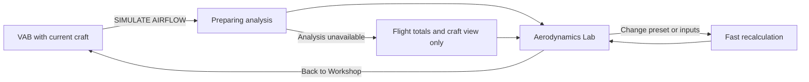
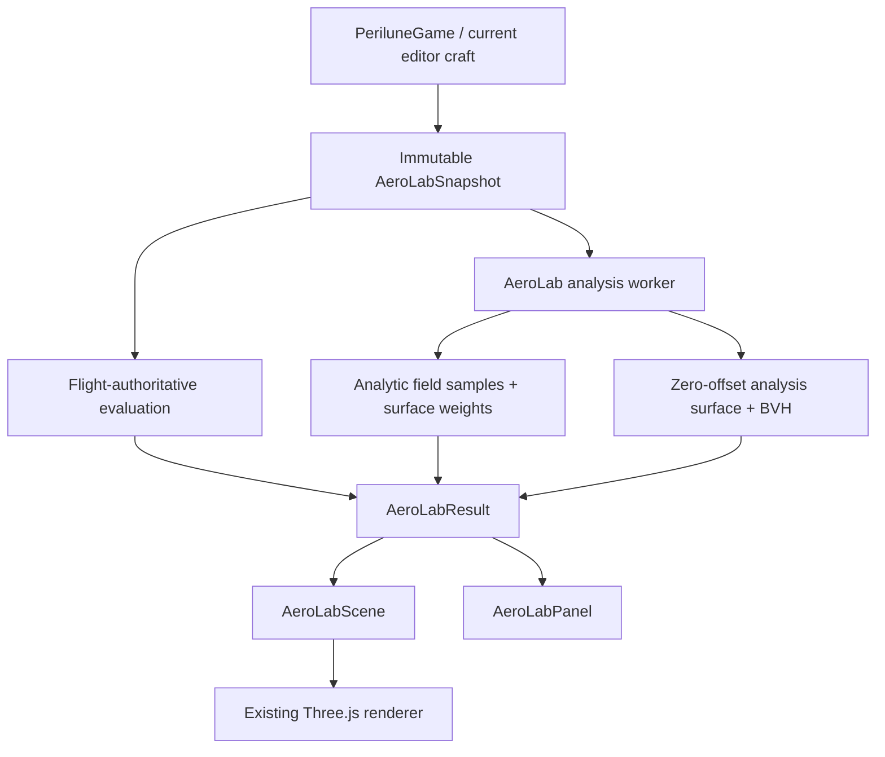

# VAB Aerodynamics Lab Implementation Plan

**Status:** Implemented 2026-07-30; future Stage 2 volumetric experiment remains out of scope

**Baseline:** `527605ee7239af0ec8decc088463743c9165a69f`

**Target:** A separate, interactive Aerodynamics Lab launched from the Vehicle Assembly Building (VAB)
**Primary constraint:** Educational and predictive, calibrated to Perilune's flight model, without presenting an approximate browser visualization as CFD

## 1. Product Decision

Add a `SIMULATE AIRFLOW` action to the VAB Environment panel. It opens a dedicated Aerodynamics Lab for the current craft. The transition may show real preprocessing progress while geometry, acceleration structures, and flow samples are prepared.

The lab combines two deliberately separate layers:

1. **Flight-authoritative analysis:** force, torque, dynamic pressure, Mach, angle of attack, mass center, the existing axial center-of-pressure estimate, and the existing heating proxy are calculated through the same simulation functions used by flight.
2. **Explanatory visualization:** animated streamlines, relative surface loading, shielding, wake, and heating exposure explain likely behavior. These are approximations and never become a second source of truth for total force or torque.

The first release uses a fast analytic source/doublet flow approximation plus mesh-based visibility and collision queries. It does not attempt a general real-time CFD solve. A denser volumetric solver is a later, benchmark-gated experiment.

### User experience



The lab contains:

- The current craft, orbitable but not editable.
- Animated streamlines and a directional flow grid.
- Surface modes: relative aerodynamic load, relative thermal exposure, and shielding.
- CoM and axial CoP markers, force and torque vectors, and a stability readout.
- Presets for Ascent, High Q, Re-entry, and Custom.
- Environment, altitude, speed/Mach, and angle-of-attack controls.
- Pause, animation-speed, streamline-density, and visualization-quality controls.
- A persistent `Back to Workshop` action.

Sideslip is excluded from v1. The existing model only responds meaningfully to it for some wing configurations, so exposing it as a general craft control would overstate fidelity.

## 2. Non-goals

- Replacing `src/sim/aero.ts` or changing flight behavior.
- Claiming Navier-Stokes, CFD, wind-tunnel, or engineering certification fidelity.
- Predicting structural failure, flutter, ablation, or control-authority margins.
- Editable craft geometry while the lab is open.
- Treating a heat-flux proxy as a material temperature prediction.
- Treating streamline-derived surface colors as independent force totals.
- Supporting Artemis mission-only vehicles in v1. The lab is launched from the normal VAB and rejects non-standard sessions defensively.

## 3. Current-State Evidence

The plan builds on the following repository behavior:

- `src/game.ts` owns screen transitions, the VAB editor, input dispatch, and the render loop. The editor currently owns string environment tokens; no token-to-`Body` analysis mapping exists yet.
- `src/sim/aero.ts` provides `buildAeroModel` and `evaluateAero`; these are the authority for the current craft's aerodynamic totals.
- `src/sim/vessel.ts` provides `computeMassProperties`, used for the CoM marker.
- `src/render/reentryGeometry.ts` already turns `PartDef` shapes into a low-resolution surface proxy, but its geometry has a 3.5 cm VFX offset, keeps buried faces, and uses a fingerprint that does not include every transform needed by an analysis cache.
- `src/render/vesselMesh.ts` may show GLB display meshes, while the physics contract remains the procedural `PartDef` proxy.
- The module-private `stepThermal` function in `src/sim/flight.ts` applies the existing heating proxy and per-part axial exposure heuristic during flight.
- `src/ui/missionTools.ts` demonstrates cancellable worker jobs and progress presentation.
- `src/proto/feasibilityScene.ts` and the `?proto=` route provide a safe prototype harness and disposable-scene pattern.
- `.github/workflows/ci.yml` runs content validation, asset compilation, unit tests, and the production build. It does not currently run Playwright or performance benchmarks.
- `docs/LEGAL.md` is the repository's third-party dependency record.

## 4. Fidelity and Authority Contract

Every displayed number or visual must declare its source. The UI uses three badges in help text and details—not decorative status dots:

- **Flight model:** same calculation used by gameplay.
- **Derived:** calculated from flight-model outputs.
- **Visual approximation:** explanatory field or normalized surface distribution.

| Output | Source | Display contract | Known limits |
|---|---|---|---|
| Atmospheric density | selected `Body.densityAt(altitude)` | Numeric with units | Zero in vacuum |
| Dynamic pressure | `evaluateAero().dynamicPressure` | Numeric with units; Flight model | Depends on current atmosphere model |
| Mach | `evaluateAero().mach` | Numeric; Flight model | Show `—` when sound speed is undefined or atmosphere is absent |
| AoA | `evaluateAero().aoa` | Numeric; Flight model | Defined from the configured flow vector |
| Drag | component of `evaluateAero().force` opposite the flow | Numeric and vector; Flight model | Tail-first and extreme hypersonic results are low confidence |
| Lift | remaining force component | Numeric and vector; Flight model | Primarily meaningful for wing panels in the current model |
| L/D | lift magnitude divided by drag magnitude | Numeric; Derived | Hide near zero dynamic pressure |
| Torque | `evaluateAero().torque` | Numeric and vector; Flight model | Aggregate vector only |
| CoM | `computeMassProperties` | Marker; Flight model | None beyond current mass model |
| Axial CoP | `buildAeroModel().copY` | Marker labeled `Axial CoP model`; Flight model | Not a field-derived pressure centroid |
| Heating flux proxy | `evaluateAero().heatFlux` | `Heating flux proxy`; Flight model | Craft-independent freestream severity, not temperature or certified W/m² |
| Stability tendency | signed relationship of CoM, axial CoP, flow direction, and restoring torque | Qualitative plus signed margin; Derived | Label low confidence when off-axis effects dominate |
| Surface aerodynamic load | normalized nonnegative weights whose sum is scaled from authoritative drag | 0–100% relative color scale; Visual approximation | No local pressure units; does not invent transverse force |
| Per-part thermal exposure | extracted axial exposure value from flight thermal code | Numeric/part callout; Flight heuristic | Constant across a part; no windward/leeward resolution |
| Surface thermal pattern | per-part flight exposure multiplied by BVH surface incidence and shielding | 0–100% relative color scale; Visual approximation | Explanatory refinement, not a flight-authoritative local value or temperature |
| Streamlines | analytic velocity field plus mesh termination | Animated geometry; Visual approximation | Not CFD; changes representation above transonic speed |
| Wake | drag-scaled deficit and deterministic particles | Animated geometry; Visual approximation | Qualitative only |

### Regime labels

The results panel always shows the active confidence note:

- **Subsonic, nose-first:** best-supported mode for the analytic field.
- **Transonic (Mach 0.8–1.2):** flight totals remain authoritative; field is illustrative and a compression band replaces smooth upstream lines near the body.
- **Supersonic (Mach > 1.2):** show a geometric shock-envelope proxy. Upstream streamlines terminate at it and separate downstream lines begin behind it; no line passes smoothly through a drawn shock.
- **Extreme hypersonic (Mach > 7):** clearly mark totals and heating as low confidence because the existing coefficient model reaches its high-Mach floor.
- **Tail-first (AoA near 180°):** mark aggregate totals low confidence because the current axial drag formulation is nearly symmetric between nose-first and tail-first attitudes.
- **Vacuum:** show craft and mass markers, set aerodynamic totals to zero, disable streamlines/load/heating, and explain that airflow does not exist in the selected condition.

## 5. Architecture



### Layering

- `src/sim/aeroLab/` contains deterministic data contracts, preset resolution, authoritative result derivation, field math, and quality budgets. It has no DOM access.
- `src/workers/aeroLabWorker.ts` owns cancellable geometry preprocessing and analytic field generation.
- `src/render/aeroLab/` owns Three.js scene objects, shaders/materials, animation, picking, and disposal.
- `src/ui/aeroLab/` owns controls, values, explanatory copy, keyboard handling, and progress/error states.
- `src/game.ts` performs explicit screen entry/exit, snapshot capture, input routing, and render-loop routing.

### Core contracts

```ts
export type AeroLabQuality = 'low' | 'medium' | 'high';
export type AeroLabPresetId = 'ascent' | 'high-q' | 'reentry' | 'custom';
export type AeroLabSurfaceMode = 'load' | 'thermal' | 'shielding' | 'off';

export interface AeroLabSnapshot {
  craftFingerprint: string;
  parts: readonly SerializedPlacedPart[];
  environmentToken: EditorEnvironmentToken;
}

export interface AeroLabCondition {
  bodyId: string;
  altitudeM: number;
  speedMps: number;
  angleOfAttackRad: number;
  quality: AeroLabQuality;
}

export interface AeroLabAuthorityResult {
  densityKgM3: number;
  dynamicPressurePa: number;
  mach: number | null;
  aoaRad: number;
  forceN: Vec3Tuple;
  dragN: number;
  liftN: number;
  torqueNm: Vec3Tuple;
  massKg: number;
  centerOfMassM: Vec3Tuple;
  axialCopM: Vec3Tuple | null;
  heatingFluxProxy: number;
  partThermalExposure: readonly AeroLabPartThermalExposure[];
  confidenceFlags: readonly AeroLabConfidenceFlag[];
}

export interface AeroLabVisualResult {
  positions: Float32Array;
  indices: Uint32Array;
  streamlinePositions: Float32Array;
  streamlineOffsets: Uint32Array;
  relativeLoad: Float32Array;
  relativeThermal: Float32Array;
  shielding: Float32Array;
  shockEnvelope: ShockEnvelope | null;
  timings: AeroLabTimings;
}
```

Worker messages include a monotonically increasing `requestId`. Every input change cancels the previous request logically; results whose ID is not current are discarded. Large typed arrays are transferred rather than cloned. `AbortController` governs UI lifecycle, while an explicit worker `cancel` message lets long station/streamline loops stop between batches.

## 6. Analysis Model

### Stage 0: characterize before calibrating

Add tests that record the current `evaluateAero` behavior rather than silently correcting it:

- Symmetric craft at AoA 0° has negligible lateral force and torque.
- Dynamic pressure is monotonic with speed at fixed density.
- Coefficients remain continuous across Mach 0.8 and 1.2 boundaries.
- Representative craft at AoA 0°, 90°, and 180°.
- Winged and non-winged craft under a small lateral flow component.
- Representative conditions at Mach 0.5, 0.9, 1.5, and 8.
- Vacuum returns zero aerodynamic force and a non-finite-safe display model.

These characterization tests establish what the lab is calibrating to. Any desired correction to flight physics is a separate change with separate balancing review.

### Analysis geometry

Extract the procedural `PartDef` surface generation from `reentryGeometry.ts` into a shared pure geometry builder with explicit options:

```ts
buildPartSurface(parts, {
  outwardOffsetM: 0,
  includeInteriorFaces: false,
  detail: 'analysis-medium',
});
```

The re-entry effect keeps its existing offset and visual behavior. The lab receives a zero-offset surface. A `three-mesh-bvh` acceleration structure supports:

- Ray/surface termination for streamlines.
- Exterior/interior classification.
- Buried-triangle removal between attached parts.
- Shielding queries and surface-incidence sampling.

The analysis fingerprint includes part definition ID, position, rotation, symmetry/mirroring, relevant dimensions, and geometry-detail version. It must not reuse the current re-entry fingerprint. A test with two stacked tanks verifies that the joined buried caps do not remain in the exterior analysis surface.

### Analytic field

Use the craft's longitudinal axis and exterior proxy to sample cross-sectional area at fixed stations. Default station counts are 48/96/160 for low/medium/high quality. Estimate the area curve `A(x)` with a bounded 2D occupancy grid against the BVH.

Construct axial source strengths from the change in cross-sectional area. The local illustrative velocity field is:

```text
v(p) = U∞ + Σ qᵢ (p − pᵢ) / (4π |p − pᵢ|³) + crossflow(p)
```

where:

- `U∞` is the selected freestream vector.
- `qᵢ` is proportional to `U∞ · dA/dx`, smoothed and clamped near discontinuities.
- `crossflow` uses bounded doublets derived from lateral projected area for nonzero AoA.
- A core radius prevents singular velocities close to a source.
- The analytic field is nondimensionalized for topology and animation; it is not integrated for total force.

Streamlines use deterministic RK4 integration with quality-tier step and count limits. A line stops when it:

- Intersects the analysis surface.
- Leaves the analysis bounds.
- Reaches the maximum step count.
- Enters a near-stagnant or non-finite region.
- Reaches a supersonic shock-envelope boundary.

The wake is a separate downstream, drag-scaled velocity-deficit envelope. It uses deterministic seeded particles and dashed/noisy rendering so it is visually distinct from upstream analytic streamlines.

### Surface distribution without conflicting totals

For each exterior triangle, compute a nonnegative raw drag weight from projected area, flow incidence, shielding, and local analytic-speed ratio. Normalize all weights so their sum is 1. Display relative weight as a 0–100% field.

If per-part force callouts are later added, distribute only the authoritative aggregate drag magnitude through these weights. Wing lift remains a separately sourced flight-model vector at the contributing panel. Do not turn unresolved transverse residuals in the approximate field into forces. The only displayed aggregate force and torque values come from `evaluateAero`.

### Shared thermal exposure and visual refinement

The current per-part exposure block is inside the module-private `stepThermal` function at `src/sim/flight.ts`. It depends on `axialFrac`, `flowAlign`, heat-shield status, and shield shadowing; it is not surface-normal- or azimuth-aware. First add characterization tests for that block's current outputs. Then extract only the pure exposure calculation into `src/sim/aeroThermalExposure.ts` and import it back into `flight.ts`. Ablator consumption, cooling, temperature integration, and destroyed-part mutation remain in `flight.ts`. This refactor must not change flight coefficients or integration behavior.

The lab shows the raw per-part axial exposure as a **Flight heuristic** callout. Its surface thermal pattern multiplies that part value by normalized BVH-derived flow incidence and shielding, and is therefore badged **Visual approximation**. This produces the expected windward/leeward explanation without misrepresenting the refined per-triangle map as flight-authoritative. The aggregate heating-flux proxy remains a separate condition value. None is described as temperature.

### Future Stage 2: volumetric experiment

A low-resolution voxel/potential or lattice solver is not part of the initial production build. It may proceed only if a prototype demonstrates all of the following on the reference-device profile defined in Section 10:

- Medium craft preparation median ≤ 500 ms and p95 ≤ 1 s.
- Interactive condition changes ≤ 250 ms when geometry is cached.
- Persistent analysis memory ≤ 32 MiB at medium quality.
- No more than 4 ms median GPU frame time attributable to the lab.
- A measurable explanatory improvement over the analytic model in an agreed craft set.

Failure to meet any gate keeps the analytic model as the shipped implementation.

## 7. Conditions and Presets

Environment resolution is new work. Add a typed `Editor.getEnvironmentToken(): EditorEnvironmentToken` accessor. `PeriluneGame`, which has access to the active `Universe`, maps that token to a real `Body` plus the initial condition passed to the analysis layer:

| Editor token | Gameplay environment |
|---|---|
| `earth-sl` | Sol / Earth sea-level starting condition |
| `earth-vac` | Sol / Earth at altitude ≥ `earth.atmosphere.height` |
| `moon` | Sol / Moon |
| `veyra-sl` | Legacy / Veyra sea-level starting condition |
| `veyra-vac` | Legacy / Veyra at altitude ≥ `veyra.atmosphere.height` |
| `palla` | Legacy / Palla |

The `*-vac` values are test conditions, not separate bodies. The analysis API accepts the resolved `Body` and condition, never an unvalidated editor string. Altitude is clamped to the body's supported range, with a visible explanation when a preset is unavailable in vacuum or above the atmosphere.

Presets are gameplay-system content in `src/content/aeroLabPresets.ts`, not hard-coded DOM values:

- **Ascent:** altitude `0.02 × atmosphere height`, Mach 0.3, AoA 0°.
- **High Q:** altitude `0.15 × atmosphere height`, a system-authored target dynamic pressure, AoA 0°. Speed is solved from local density and the target, then clamped to the model's supported range.
- **Re-entry:** altitude `0.55 × atmosphere height`, Mach 6.5 or the system-authored re-entry reference, AoA 180°. Tail-first confidence language is intentional for heat-shield-first analysis; keeping the default below Mach 7 avoids stacking the separate extreme-hypersonic warning on the marquee preset.
- **Custom:** initialized from the last valid condition for that gameplay system.

For airless bodies, only Custom is enabled and aerodynamic output remains zero. Preset values are reference conditions, not a claim that the player's trajectory will pass through them exactly.

## 8. Screen and Lifecycle Integration

Add `'aero-lab'` everywhere screen state is exhaustively represented:

- `Screen` in `src/game.ts`.
- `BindingScreen` and explicit input dispatch guards.
- `WindowScreen` and window-launcher host selection.
- `TutorialContext.screen`; tutorial logic takes no action in the lab.
- `frame()` render/update branch.
- Pointer, wheel, keyboard, and resize routing.
- The game `__TEST__` surface needed by integration tests.

Do not rely on the existing unsafe `as BindingScreen` casts. Introduce an explicit `isBindingScreen` guard or switch so adding another screen cannot silently route editor commands into the lab.

### Entry

`enterAeroLab()`:

1. Validates a standard editor session and a nonempty craft.
2. Captures an immutable serialized snapshot and revision.
3. Hides editor windows and disables editor input without destroying editor state.
4. Sets the launcher host to `null`, screen to `'aero-lab'`, and displays the first paint of the loading view.
5. Dynamically imports the lab chunk and starts analysis on the following task/frame.
6. Makes progress reflect actual completed phases: importing, building surface, building acceleration data, tracing flow, and uploading visuals.

### Exit

`restoreEditorFromAeroLab()` is a dedicated restoration path. It must not call ordinary `toEditor()`, because that path includes save/warm/session logic intended for returning from flight and may invoke Artemis guards.

Restoration:

- Cancels analysis and removes lab subscriptions through the existing restoration/disposal patterns.
- Disposes geometries, materials, render targets, worker, DOM listeners, and WebGL resources.
- Restores the exact editor windows, camera, selection, environment, immutable craft state, and launcher host captured at entry.
- Performs no autosave and no craft mutation.

No editor craft-revision counter exists today. On exit, recompute the transform-complete craft fingerprint from current editor state and compare it with the snapshot fingerprint. If they differ despite editor input being disabled, discard the cached result, log the boundary failure, and restore the editor without applying anything from the snapshot.

## 9. Rendering and Interaction

### Scene

`AeroLabScene` owns a separate scene graph while reusing the application renderer:

- Neutral wind-tunnel background and subtle spatial grid.
- Craft proxy using current visible materials where possible, with a surface-overlay shader.
- GPU-instanced streamline ribbons or line segments with a time-based moving highlight.
- Instanced arrow glyphs for force, lift/drag decomposition, and torque.
- CoM and axial CoP markers with labels in the UI overlay.
- Optional shock-envelope mesh using a distinct translucent material.

The visual design does not add pulsing connection dots or decorative status indicators. Progress is shown as labeled work phases with a progress bar only when real work is underway.

### Controls

- Left drag: orbit.
- Right drag or modified left drag: pan.
- Wheel/pinch: zoom.
- Space: pause/resume animation.
- Escape: Back to Workshop, after closing any open help popover.
- Keyboard-accessible sliders with visible values and step buttons.
- `prefers-reduced-motion`: animation starts paused and moving highlights are replaced by static direction arrows.

Changing altitude, speed, or AoA updates flight-authoritative totals immediately on the main thread. Debounce worker visual recomputation by 100 ms during continuous slider movement, show the previous field dimmed, and replace it atomically when the latest request finishes.

## 10. Loading, Caching, and Failure Behavior

- Lazy-load the lab code and `three-mesh-bvh`; the initial menu/VAB bundle should not absorb the full dependency.
- Optionally prefetch the lazy chunk during genuine VAB idle time after the craft editor is usable.
- Cache geometry/BVH results by the full analysis fingerprint and geometry-detail version.
- Cache no more than the most recent two craft/quality combinations.
- Condition-only changes reuse geometry and acceleration data.
- A 2-second analysis deadline offers `Continue with simplified view`; it does not fake a failure if work completes later.
- Simplified view retains the craft, flight totals, vectors, CoM/CoP, and a basic freestream particle layer, but disables surface maps and detailed streamlines.
- Worker, shader, and WebGL failures use the existing structured client logger, for example `clientLog.warn('sim.boundary.error', { boundary: 'aero-lab-worker', errorType })`; do not log serialized craft content.

The reference profile extends the repository's existing feasibility-certification target: MacBook Pro `Mac15,10`, Apple M3 Max with 30 GPU cores, 36 GB unified memory, stable headed Google Chrome, a 1920×1080 drawing buffer, AC power, and `powermode 0` with automatic thermal management. Record the exact macOS and Chrome builds used by each run. Before the first benchmark, add `docs/performance/reference/aero-lab-reference-device.md` containing this profile and the benchmark command; raw host records must remain sanitized like the existing host-observation tooling.

Provisional production budgets on that reference profile:

| Budget | Target | Hard action |
|---|---:|---|
| First loading paint after click | ≤ 100 ms | Treat as a blocking UI regression |
| Medium craft full preparation, warm JS | median ≤ 250 ms; p95 ≤ 750 ms | Offer simplified view at 2 s |
| Cached condition recalculation | median ≤ 150 ms; p95 ≤ 300 ms | Reduce streamline tier for session |
| Lab update CPU time | p95 ≤ 2 ms/frame | Lower moving sample count |
| Lab GPU time, medium quality | median ≤ 4 ms/frame | Automatically choose low quality |
| Persistent analysis memory | ≤ 16 MiB medium; ≤ 32 MiB high | Reject tier and fall back one level |
| Initial application gzip delta | ≤ 5 KiB | Fix eager import before merge |
| Total lazy lab + worker gzip delta | ≤ 250 KiB | Record and approve an exception or reduce dependency/code |

Stage 0 measures these values. If the target device results require different budgets, change the table through a documented architecture decision before production implementation rather than silently weakening assertions.

## 11. Dependency Decision

Use [`three-mesh-bvh`](https://github.com/gkjohnson/three-mesh-bvh) for spatial queries, subject to the Stage 0 bundle and performance spike.

Reasons:

- MIT licensed.
- Compatible with the repository's Three.js version range.
- Provides BVH ray queries, shapecast support, serialization, and worker-oriented examples.
- Useful for geometry cleanup, shielding, streamline termination, and future field experiments without importing a misleading CFD package.

Record its version, license, copyright, source URL, and usage in `docs/LEGAL.md`. The worker build may pull Three.js into a second lazy chunk, so CI must inspect the built chunk graph and gzip sizes. If the package fails the lazy-bundle budget, implement a narrow triangle BVH behind the same `SurfaceQuery` interface rather than weakening initial-load performance.

The researched browser wind-tunnel libraries are not adopted: available open implementations are primarily 2D educational solvers, limited to simple obstacles, or frontends for server-side OpenFOAM. They are useful references but do not fit Perilune's arbitrary assembled 3D craft and client-only runtime.

## 12. Implementation Sequence

Each task ends with its listed verification before the next task begins.

### Task 0: characterization and feasibility harness

**Files**

- Add `tests/aero-characterization.test.ts`.
- Add `src/proto/aeroLabScene.ts` and register `?proto=aero-lab` beside existing prototypes.
- Add `src/sim/aeroLab/contracts.ts` and `src/sim/aeroLab/quality.ts`.
- Add `docs/performance/reference/aero-lab-reference-device.md` with the Section 10 profile and benchmark protocol.
- Add a local benchmark entry point under the existing prototype/benchmark convention.

**Work**

- Lock current flight-aero behavior across the matrix in Section 6.
- Prototype cross-section sampling, analytic flow, RK4 tracing, and surface hits on representative small/medium/large craft.
- Compare main-thread and worker BVH construction; ship worker construction if main-thread work exceeds one 16 ms frame for the medium craft.
- Capture bundle, timing, memory, and frame-profile results.

**Gate**

- Characterization suite passes without changing flight coefficients.
- Analytic prototype meets the medium-craft preparation target or the plan is revised before UI work.
- Decision note records selected BVH construction strategy.

### Task 1: shared analysis geometry

**Files**

- Add `src/render/partSurfaceGeometry.ts` or a simulation-safe typed-array equivalent.
- Refactor `src/render/reentryGeometry.ts` to call it with existing VFX options.
- Add `src/sim/aeroLab/fingerprint.ts` and `src/sim/aeroLab/surface.ts`.
- Add focused geometry/fingerprint tests.

**Work**

- Preserve re-entry output while adding zero-offset analysis output.
- Add transform-complete fingerprinting.
- Build exterior filtering and shielding queries.
- Serialize only typed-array data across the worker boundary.

**Gate**

- Before/after re-entry geometry snapshots or counts demonstrate no visual-path regression.
- Translation, rotation, mirroring, and dimension changes invalidate the analysis fingerprint.
- Stacked-part fixture removes buried caps and retains exterior walls.

### Task 2: authoritative analysis and presets

**Files**

- Add `src/sim/aeroLab/evaluate.ts`.
- Add `src/content/aeroLabPresets.ts`.
- Add `src/sim/aeroThermalExposure.ts` and refactor only the pure exposure block out of the private `stepThermal` function in `src/sim/flight.ts`; leave ablator, cooling, temperature, and destruction mutations in place.
- Add unit tests for authority labels, regime flags, preset resolution, and thermal exposure.

**Work**

- Build the `AeroLabAuthorityResult` only from existing simulation functions and derived decompositions.
- Add the typed editor environment accessor and map its tokens to actual bodies/conditions through the active `Universe` at the game boundary.
- Implement vacuum, transonic, supersonic, hypersonic, and tail-first confidence flags.
- Before extracting thermal exposure, add focused characterization tests for its current axial/shield values; then keep the raw per-part flight value, approximate surface refinement, and aggregate heating proxy separate.

**Gate**

- For identical craft/body/velocity inputs, lab force, torque, q, Mach, AoA, and heating proxy equal direct simulation outputs within floating-point tolerance.
- New exposure characterization tests pass before and after extraction, and the existing ascent tolerance remains unchanged.
- Invalid presets cannot produce NaN/Infinity in the UI model.

### Task 3: worker and visual field

**Files**

- Add `src/workers/aeroLabWorker.ts`.
- Add `src/sim/aeroLab/analyticField.ts`, `streamlines.ts`, `surfaceWeights.ts`, and `shockEnvelope.ts`.
- Add worker protocol, cancellation, determinism, normalization, and resource-budget tests.

**Work**

- Implement source/doublet construction, deterministic RK4 traces, wake envelope, surface weights, and regime-specific shock termination.
- Return transferable typed arrays and timing counters.
- Support low/medium/high tiers and cancellation between bounded batches.

**Gate**

- Identical snapshot/condition/quality inputs produce byte-stable or tolerance-stable results.
- All field arrays are finite and within explicit allocation limits.
- Surface weights are nonnegative and normalize to 1 when drag is nonzero.
- Supersonic upstream lines terminate at the shock proxy and never continue through it.
- Stale/cancelled worker results never become visible.

### Task 4: lab rendering

**Files**

- Add `src/render/aeroLab/AeroLabScene.ts`, `StreamlineRenderer.ts`, `SurfaceOverlay.ts`, `VectorGlyphs.ts`, and `ShockEnvelopeRenderer.ts`.
- Reuse or adapt the existing disposal helper.
- Add render-object lifecycle tests where practical.

**Work**

- Build the lab scene and camera controller.
- Implement surface modes and quality-based instancing.
- Add reduced-motion rendering.
- Make all GPU resources explicitly disposable.

**Gate**

- Repeated open/close cycles return renderer memory counters to baseline within expected caching tolerance.
- No per-frame geometry/material allocations in a steady lab session.
- Low quality remains usable on an intentionally throttled profile.

### Task 5: UI and game integration

**Files**

- Add `src/ui/aeroLab/AeroLabPanel.ts` and styles following existing UI conventions.
- Update `src/game.ts`, screen/binding types, window management, tutorial context, and input help.
- Add the VAB Environment-panel action.
- Extend `__TEST__` only with narrow lab inspection hooks.

**Work**

- Implement explicit `enterAeroLab()` and `restoreEditorFromAeroLab()`.
- Route frame, pointer, keyboard, resize, and visibility events.
- Wire presets, custom controls, help text, progress, retry, simplified mode, and Back.
- Keep the snapshot immutable and editor state alive.

**Gate**

- Empty craft disables the action with an explanation.
- Standard VAB craft opens the lab; Artemis/non-editor sessions cannot.
- Escape and Back restore exact craft JSON, selection, camera, environment, and visible windows.
- Opening/closing causes no autosave, no warm-session side effect, and no craft fingerprint change.
- Lab input cannot place, delete, rotate, stage, or launch parts.

### Task 6: accessibility, performance, and failure hardening

**Files**

- Add targeted Playwright coverage under the repository's existing E2E convention.
- Update the Task 0 reference-device record with final benchmark usage/results, and add resource-budget assertions.
- Update `docs/LEGAL.md`.

**Work**

- Keyboard and screen-reader pass for controls and result changes.
- Honor reduced motion and contrast requirements for color maps with patterns/legends.
- Exercise worker failure, WebGL context restoration, rapid input changes, and repeated entry/exit.
- Inspect production chunk graph and gzip sizes.

**Gate**

- All budgets in Section 10 pass or have an explicit approved decision record.
- No initial-bundle eager import of the lab or BVH library.
- Error logs contain boundary/type only, not craft payloads.
- Third-party notice is complete.

### Task 7: release verification

Run:

1. Content validation and asset compilation.
2. Unit and integration tests, including aero characterization and lab resource budgets.
3. Production build and chunk-size inspection.
4. Targeted Playwright flows for open, analyze, change inputs, cancel stale work, simplify on timeout, and exact editor restoration.
5. Manual visual/performance profile on the Section 10 reference device using representative small, medium, and large craft in subsonic, transonic, supersonic, re-entry, tail-first, and vacuum conditions; capture exact OS, stable Chrome build, drawing buffer, and power state.

Unit/integration/build remain CI gates. Before release, add the targeted lab Playwright flow to CI or explicitly document it as a required local release gate; do not describe an unexecuted browser test as CI coverage.

## 13. Acceptance Criteria

The feature is ready when:

- A user can launch a separate lab from the current nonempty VAB craft and return without any craft/editor mutation.
- Flight-model numbers exactly match direct simulation evaluation for the same inputs.
- Approximate visuals are visibly and consistently distinguished from authoritative totals.
- The lab handles atmospheric bodies, airless bodies, invalid conditions, worker failure, cancellation, and slow preparation without trapping the user.
- Subsonic, transonic, supersonic, extreme hypersonic, and tail-first regimes display the correct confidence language and representation.
- The analytic model meets the performance and memory budgets on the reference device.
- Screen/input/tutorial/window state is exhaustive and does not rely on unsafe casts.
- Re-entry geometry and thermal behavior remain unchanged after shared-helper extraction.
- Dependency/license records, production bundle inspection, tests, and release profiling are complete.

## 14. Decision Log

1. **Separate screen, not a VAB overlay:** allows an immersive tool, focused controls, and isolated rendering/lifecycle while preserving the craft snapshot.
2. **Flight totals are authoritative:** avoids maintaining two conflicting physics models.
3. **Analytic field before volumetric solver:** gives craft-aware 3D flow topology within browser budgets and keeps the result honest.
4. **No v1 sideslip control:** the existing response is not general enough to teach it reliably.
5. **Relative surface fields:** avoids false local-pressure precision while still explaining shielding and load concentration.
6. **Dedicated editor restore path:** prevents flight-return side effects and preserves exact VAB state.
7. **Lazy `three-mesh-bvh`:** acceleration queries justify the dependency only if the isolated chunk meets measured budgets.
8. **Prototype and characterization first:** fidelity claims and resource budgets are verified before production UI investment.
